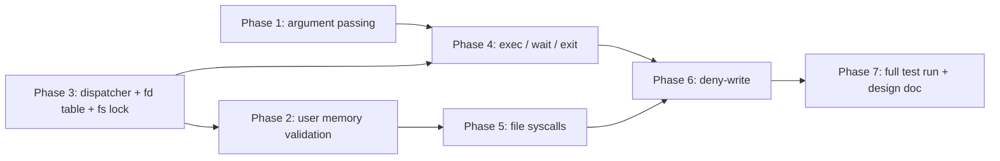

# Pintos Development Plans

Implementation plans for every lab phase. **Workflow agreed:**

1. Plans (this folder) → 2. Design document → 3. Implementation → 4. Testing.

> **Priority**: Lab 2 (User Programs) is due **Wed 28 Oct 2026, 11:59 PM**
> (see [Instructions_moodle.txt](../labs/Instructions_moodle.txt)).
> Deliverables: updated design doc, source code, test-summary screenshots.
> Lab 0 and Lab 1 plans are included for completeness.

## Index

| # | Plan | Spec | Main files | Tests |
|---|------|------|-----------|-------|
| 00 | [Lab 0 — Kernel monitor & boot tracing](./00-lab0-kernel-monitor.md) | [P0](../labs/P0_kernal_monitor.md) | `threads/init.c` | manual |
| 01 | [Lab 1 — Threads](./01-lab1-threads.md) | [P1](../labs/P1_threads.md) | `devices/timer.c`, `threads/*` | 27 (`tests/threads`) |
| 02 | [Lab 2 / Phase 1 — Argument passing](./02-lab2-phase1-argument-passing.md) | [P2](../labs/P2_user_programs.md) | `userprog/process.c` | `args-*` (5) |
| 03 | [Lab 2 / Phase 2 — User memory access](./03-lab2-phase2-user-memory-access.md) | | `userprog/syscall.c`, `exception.c` | `sc-*`, `bad-*` |
| 04 | [Lab 2 / Phase 3 — Syscall infrastructure & fd table](./04-lab2-phase3-syscall-infrastructure.md) | | `userprog/syscall.c`, `threads/thread.[ch]` | `halt`, `exit` |
| 05 | [Lab 2 / Phase 4 — Process control (exec/wait/exit)](./05-lab2-phase4-process-control.md) | | `userprog/process.c`, `thread.[ch]` | `exec-*`, `wait-*`, `multi-*` |
| 06 | [Lab 2 / Phase 5 — File syscalls](./06-lab2-phase5-file-syscalls.md) | | `userprog/syscall.c` | `create-*`, `open-*`, `close-*`, `read-*`, `write-*` |
| 07 | [Lab 2 / Phase 6 — Deny writes to executables](./07-lab2-phase6-deny-write.md) | | `userprog/process.c` | `rox-*` |
| 08 | [Lab 2 / Phase 7 — Testing, design doc, submission](./08-lab2-phase7-testing-and-submission.md) | | `userprog/DESIGNDOC` | full `make check` |

## Recommended Lab 2 Order & Dependencies

Practical build order: **1 → 3 → 2 → 4 → 5 → 6 → 7**.
Reason: `args-*` tests need `write` and `exit` to print anything, so Phase 1
is tested together with a minimal Phase 3 (`exit` + `write` to fd 1) and
a temporary `process_wait` (see Phase 4 §"Bootstrap").

## Key Findings From the Codebase (verified)

- `userprog/syscall.c` is a 20-line stub (prints `system call!`, exits).
- `process_execute()` passes the **whole command line** as thread name.
- `process_wait()` returns `-1` immediately → Pintos shuts down before the
  user program finishes. A temporary blocking wait is needed first.
- `setup_stack()` sets `*esp = PHYS_BASE` only; no arguments pushed.
- `load()` calls `file_close(file)` at the end → executable is **not** write-protected.
- `struct thread` has **no** USERPROG fields beyond `pagedir`.
- `thread_exit()` already calls `process_exit()` (under `#ifdef USERPROG`), so
  the single place to clean up/print/exit-status is `process_exit()`.
- `tests/userprog/Make.tests` lists **76 tests** (no `multi-oom` in this tree;
  `rox-*`, `exec-bound*`, `wait-*`, `sc-*` are included).
- Many `.ck` files accept **either** "return error" **or** "exit(-1)" for
  bad fds / stdin-stdout misuse; `IGNORE_USER_FAULTS` filters kernel
  fault messages from the expected output.
- **No DESIGNDOC template exists in the repo** (searched). The structure
  must be recreated from the standard Pintos design-doc layout (see Phase 7).
- Docker daemon was **not running** when last checked (`docker ps` failed).

## Conventions Used In The Plans

- ✅ = acceptance criterion; ⚠️ = pitfall; 🔬 = how to verify.
- Code blocks are **sketches/pseudocode**, not final code.
- All paths are relative to `pintos/src/` unless prefixed with `docs/`.
