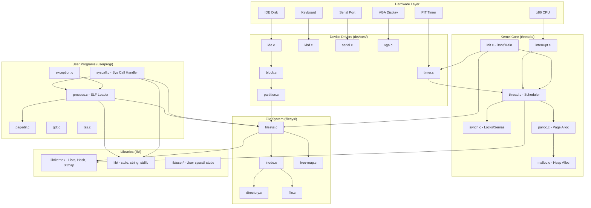
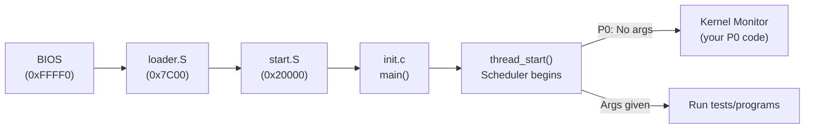
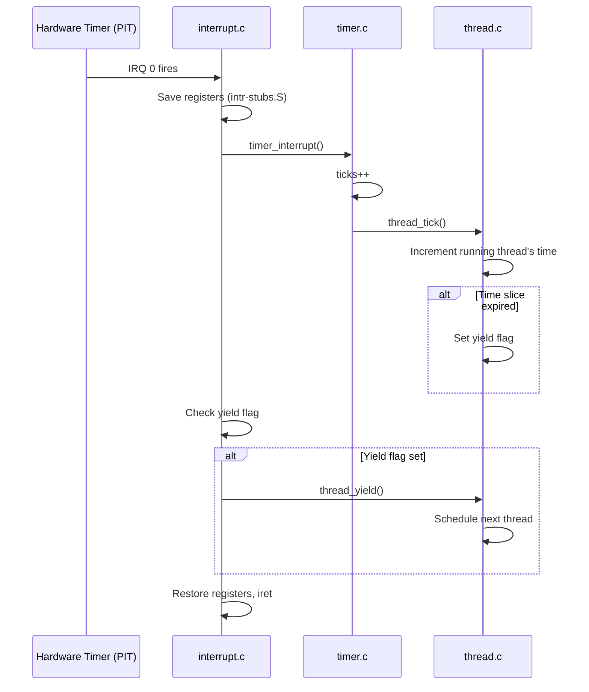

# Pintos OS — Architecture & Big-Picture Overview

## 1. Executive Summary & Mental Model

Pintos is a **teaching operating system** for the 80x86 (IA-32) architecture. Think of it as a **small house** where every room (subsystem) is visible and comprehensible — unlike a production OS like Linux (a skyscraper with thousands of floors).

**Real-world analogy**: Pintos is like a **single-story office building**:
- The **reception desk** (bootloader) gets people into the building
- The **office manager** (kernel threads) decides who works in which room and when
- The **intercom system** (interrupts) lets devices demand attention
- The **filing cabinet** (file system) stores documents
- The **front desk clerk** (system calls) handles requests from visitors (user programs)

**Primary CS problems solved**:
- **CPU multiplexing**: How do multiple threads share one CPU?
- **Memory protection**: How do we prevent user programs from corrupting the kernel?
- **Synchronization**: How do concurrent threads safely share data?
- **Abstraction**: How do we present a simple interface over complex hardware?

## 2. Theoretical Foundations

### Monolithic Kernel Architecture

Pintos uses a **monolithic kernel** design — all kernel code (threads, file system, device drivers, memory management) runs in a single address space at **privilege level 0** (ring 0 on x86). This contrasts with:

| Architecture | Example | Kernel Size | IPC Cost | Reliability |
|---|---|---|---|---|
| **Monolithic** | Pintos, Linux | Large | Low (direct calls) | One bug can crash everything |
| **Microkernel** | Minix, L4 | Small | High (message passing) | Isolated failures |
| **Hybrid** | Windows NT, macOS | Medium | Medium | Compromise |

Pintos chose monolithic because:
1. **Simplicity** — no message-passing infrastructure needed
2. **Performance** — direct function calls between subsystems
3. **Educational clarity** — everything is visible in one address space

### The x86 Protection Model

The Intel x86 provides **4 privilege rings** (0–3). Pintos uses only two:
- **Ring 0 (kernel mode)**: Full hardware access — runs the Pintos kernel
- **Ring 3 (user mode)**: Restricted — runs user programs (starting in Project 2)

Transitions between rings happen via:
- **Interrupts** (hardware → kernel)
- **System calls** (`int $0x30`) (user → kernel)
- **`iret` instruction** (kernel → user)

### Memory Layout

```
  4 GB  +----------------------------------+
        |                                  |
        |    Kernel Virtual Memory         |  Identity-mapped to physical memory
        |    (accessible only in ring 0)   |  starting at PHYS_BASE
        |                                  |
 PHYS_BASE (0xC0000000 = 3 GB)            |
        +----------------------------------+
        |                                  |
        |    User Virtual Memory           |  Per-process, managed by page tables
        |    (accessible in ring 0 and 3)  |
        |                                  |
   0    +----------------------------------+
```

## 3. Architecture & Visual Topography

### Subsystem Dependency Map



### Boot Sequence Flow



### Directory-to-Subsystem Map

| Directory | Role | Labs You Modify It |
|---|---|---|
| `threads/` | Kernel core: threads, scheduling, synchronization, memory | P0, P1, P2 |
| `devices/` | Hardware drivers: timer, keyboard, disk, VGA, serial | P1 (timer only) |
| `userprog/` | User program loading, system calls, exceptions | P2 |
| `filesys/` | File system: inodes, directories, free-map | Used in P2 (not modified) |
| `vm/` | Virtual memory (stubs) | Not in scope |
| `lib/` | Shared C library (printf, string, lists, hash tables) | Rarely modified |
| `lib/kernel/` | Kernel-only data structures (lists, bitmaps, hash tables) | Not modified |
| `lib/user/` | User-space syscall stubs and entry point | Not modified |
| `tests/` | Test cases for grading | Not modified (replaced at grading) |
| `utils/` | Host-side utilities (pintos script, gdb macros) | Not modified |
| `examples/` | Example user programs (shell, cat, echo) | Not modified |
| `misc/` | Build toolchain patches | Not modified |

## 4. Source Code Anatomy & Deep Dive

### How the Codebase is Organized

The source tree follows a consistent pattern:

1. **Each subsystem** lives in its own directory (`threads/`, `devices/`, etc.)
2. **Header files** (`.h`) declare public interfaces; **source files** (`.c`) implement them
3. **Assembly files** (`.S`) handle hardware-specific operations (boot, context switch, interrupts)
4. **`Make.vars`** in each subsystem directory configures what gets compiled for that project
5. **Conditional compilation** via `-D` flags: `-DUSERPROG`, `-DFILESYS`, `-DVM` enable subsystems

### Key Build Configurations

| Build From | `DEFINES` | Subsystems Included | Used For |
|---|---|---|---|
| `threads/` | *(none)* | threads, devices, lib | P0, P1 |
| `userprog/` | `-DUSERPROG -DFILESYS` | threads, devices, lib, userprog, filesys | P2 |
| `vm/` | `-DUSERPROG -DFILESYS -DVM` | all of above + vm | P3 |
| `filesys/` | `-DUSERPROG -DFILESYS` | same as userprog | P4 |

### Critical Data Structure: `struct thread`

Every thread in Pintos is represented by a `struct thread` that sits at the **bottom** of a 4 KB page. The kernel stack grows downward from the **top** of the same page:

```
    4 kB +---------------------------------+
         |          kernel stack           |
         |                |                |
         |                V                |
         |         grows downward          |
         |                                 |
         +---------------------------------+
         |              magic              |  ← Stack overflow detection
         |              name               |
         |             status              |
    0 kB +---------------------------------+  ← struct thread starts here
```

This layout means:
- `struct thread` must stay small (< 1 kB) to leave room for the stack
- Stack overflow corrupts the `magic` field, which `thread_current()` checks
- You get the current thread by masking the stack pointer: `(struct thread *)(esp & ~0xFFF)`

## 5. Runtime Execution & Sequence

### Life of a Timer Tick



## 6. Edge Cases, Failure Modes & Resilience

| Failure | Symptom | Defensive Pattern |
|---|---|---|
| Stack overflow | `magic` field corrupted → assertion in `thread_current()` | Keep `struct thread` small; no large local variables |
| Interrupt storm | Timer tick missed → thread gets too much/too little CPU | Pintos tracks ticks atomically with `int64_t` |
| Null pointer deref in kernel | Page fault → kernel panic | `ASSERT` macros throughout |
| User program accesses kernel memory | Page fault → process terminated | Page tables enforce protection |
| Double-free in palloc | Corruption of free page bitmap | Bitmap tracks allocated pages |

## 7. Hands-On Verification & Challenges

<details>
<summary><strong>Q1: Why does Pintos use a monolithic kernel instead of a microkernel?</strong></summary>

Simplicity and performance. In a monolithic kernel, subsystems communicate via direct function calls (e.g., `filesys_open()` called from `syscall.c`). A microkernel would require message-passing IPC, adding complexity inappropriate for a teaching OS. The trade-off is that a bug in any kernel component can crash the entire system.
</details>

<details>
<summary><strong>Q2: What happens if you declare <code>int buf[1000]</code> as a local variable in a kernel function?</strong></summary>

This allocates 4000 bytes on the kernel stack, which is only ~3 KB (4 KB page minus `struct thread` size). It would overflow the stack, corrupting the `magic` field in `struct thread`, causing `thread_current()` to trigger `ASSERT(is_thread(t))` — a kernel panic. Use `palloc_get_page()` or `malloc()` instead.
</details>

<details>
<summary><strong>Q3: How does Pintos determine the currently running thread without a dedicated register?</strong></summary>

It masks the current stack pointer: `(struct thread *)((uint8_t *)&some_local_var & ~0xFFF)`. Since each thread's stack is page-aligned and `struct thread` is at the bottom of the page, masking off the low 12 bits gives the thread pointer. See `running_thread()` in `thread.c`.
</details>

**Challenge**: Trace the boot sequence from BIOS to `main()` using GDB. Set breakpoints at `0x7C00` (loader), `start` (start.S), and `pintos_init` (init.c). Document the physical → virtual address transition that happens in `start.S`.

## 8. Lab Modifications Guide

This file is an **overview module** — it is not directly modified in any lab. However, understanding this architecture is **prerequisite** to every lab:

| Lab | What This Module Prepares You For |
|---|---|
| P0 | Understanding `init.c`'s role and where to add the kernel monitor |
| P1 | Understanding how `thread.c` and `timer.c` fit into the interrupt-driven scheduling model |
| P2 | Understanding the kernel/user boundary, system call flow, and how `userprog/` connects to `threads/` |
