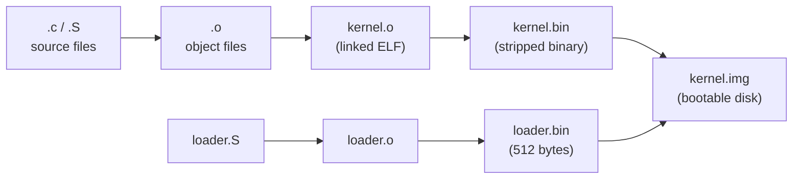
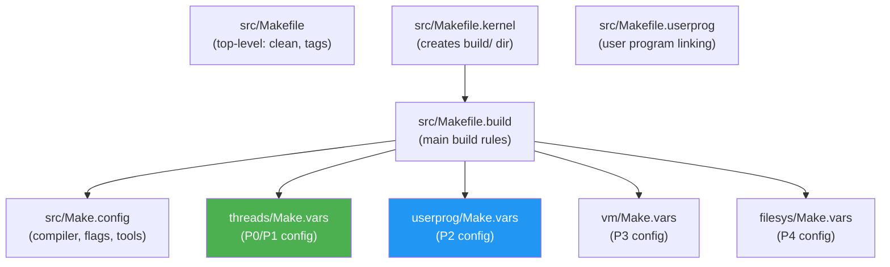
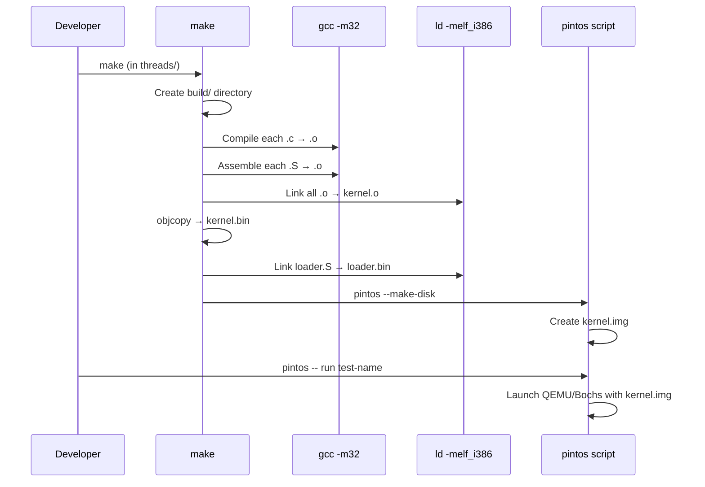

# Pintos Build System — Makefiles, Compilation & Linking

## 1. Executive Summary & Mental Model

The Pintos build system is like a **recipe book** with multiple recipes (one per project). Each recipe specifies which ingredients (source files) to include and how to combine them (compile + link) into a final dish (bootable kernel image).

**Real-world analogy**: Building Pintos is like assembling a car in stages:
1. **Make.vars** = the parts list (which subsystems to include)
2. **Make.config** = the factory settings (compiler, flags, tools)
3. **Makefile.build** = the assembly manual (how to compile and link everything)
4. **kernel.lds.S** = the blueprint (where each part goes in memory)

**Primary CS problems solved**:
- How to compile a bare-metal OS with no standard library
- How to conditionally include subsystems per project phase
- How to produce a bootable disk image from compiled object files

## 2. Theoretical Foundations

### Cross-Compilation

Pintos targets the **i386 (32-bit x86)** architecture. Since your host machine likely runs 64-bit, the build uses cross-compilation flags:
- `-m32`: Generate 32-bit code
- `-nostdinc`: Don't use the host's standard C headers (Pintos has its own)
- `-msoft-float`: No hardware floating-point (Pintos doesn't save FPU state on context switch)
- `-fno-stack-protector`: Disable GCC's stack protector (not supported in Pintos)

### The Build Pipeline



## 3. Architecture & Visual Topography

### Makefile Hierarchy



### How `make` Works Per Project

When you run `make` from a project directory (e.g., `threads/`):

1. `threads/Makefile` includes `threads/Make.vars` → sets `KERNEL_SUBDIRS` and `DEFINES`
2. Copies `Makefile.build` into `build/Makefile`
3. Compiles all `.c` and `.S` files from specified subdirectories into `.o` files
4. Links all `.o` into `kernel.o` using `kernel.lds.S` as the linker script
5. Strips debug info → `kernel.bin`
6. Builds `loader.bin` from `loader.S`
7. Combines both into `kernel.img` (bootable disk image)

## 4. Source Code Anatomy & Deep Dive

### `Make.config` — Global Compiler Settings

Key settings with their purpose:

| Setting | Value | Why |
|---|---|---|
| `CC = $(GCCPREFIX)gcc` | GCC compiler | Cross-compiler prefix auto-detected |
| `CFLAGS = -m32 -g -msoft-float -O0` | 32-bit, debug info, no FPU, no optimization | Bare-metal i386 target |
| `CPPFLAGS = -nostdinc -I$(SRCDIR) -I$(SRCDIR)/lib` | No host headers | Uses Pintos's own lib/ headers |
| `WARNINGS = -Wall -W -Wstrict-prototypes...` | Strict warnings | Catches common bugs early |
| `LDOPTIONS = -melf_i386` | ELF 32-bit linking | Produce i386 ELF binaries |

### `Make.vars` — Per-Project Configuration

Each project directory has a `Make.vars` that controls what gets built:

**`threads/Make.vars`** (P0 and P1):
```makefile
kernel.bin: DEFINES =                     # No special defines
KERNEL_SUBDIRS = threads devices lib lib/kernel $(TEST_SUBDIRS)
TEST_SUBDIRS = tests/threads              # Only thread tests
SIMULATOR = --bochs                       # Bochs for reproducibility
```

**`userprog/Make.vars`** (P2):
```makefile
kernel.bin: DEFINES = -DUSERPROG -DFILESYS # Enable user programs + file system
KERNEL_SUBDIRS = threads devices lib lib/kernel userprog filesys
TEST_SUBDIRS = tests/userprog tests/userprog/no-vm tests/filesys/base
SIMULATOR = --qemu                        # QEMU is faster for user programs
```

The `-DUSERPROG` flag is critical — it activates code guarded by `#ifdef USERPROG` throughout the kernel (e.g., `pagedir` field in `struct thread`).

### `Makefile.build` — The Main Build Engine

This file lists every source file organized by subsystem:

```makefile
# Core kernel
threads_SRC  = threads/start.S        # Startup code
threads_SRC += threads/init.c          # Main program
threads_SRC += threads/thread.c        # Thread management
threads_SRC += threads/switch.S        # Context switch
threads_SRC += threads/interrupt.c     # Interrupt handling
threads_SRC += threads/intr-stubs.S    # Interrupt stubs
threads_SRC += threads/synch.c         # Synchronization
threads_SRC += threads/palloc.c        # Page allocator
threads_SRC += threads/malloc.c        # Heap allocator
```

**When you add a new source file** (like `fixed-point.h` for P1), you add it to the appropriate `_SRC` variable in `Makefile.build`.

### Build Outputs

| File | Content | Size |
|---|---|---|
| `kernel.o` | Full kernel with debug symbols | ~500 KB |
| `kernel.bin` | Stripped kernel binary | < 512 KB (hard limit) |
| `kernel.asm` | Disassembly (for debugging) | Large |
| `kernel.sym` | Symbol table | Small |
| `loader.bin` | Bootloader | Exactly 512 bytes |
| `kernel.img` | Bootable disk image | kernel + loader combined |

## 5. Runtime Execution & Sequence

### From `make` to Running



## 6. Edge Cases, Failure Modes & Resilience

| Problem | Cause | Fix |
|---|---|---|
| `kernel.bin` exceeds 512 KB | Too much code/data | The linker script enforces this limit; reduce code |
| `loader.bin` exceeds 512 bytes | Impossible — it's exactly 512 bytes by `.org` directives | Should never happen |
| Missing cross-compiler | `GCCPREFIX` not set | Install `i386-elf-gcc` or use Docker container |
| "No rule to make target" | New `.c` file not added to `Makefile.build` | Add to the appropriate `_SRC` variable |
| Tests don't compile | Wrong `TEST_SUBDIRS` in `Make.vars` | Check your project's `Make.vars` |

## 7. Hands-On Verification & Challenges

<details>
<summary><strong>Q1: Why does Pintos use <code>-O0</code> (no optimization) instead of <code>-O2</code>?</strong></summary>

With `-O0`, the compiled code closely matches the source, making debugging with GDB much easier. Optimized code reorders instructions, inlines functions, and eliminates variables, making breakpoints and variable inspection unreliable. Since Pintos is a teaching OS, debuggability is prioritized over performance.
</details>

<details>
<summary><strong>Q2: What happens if you forget to add a new <code>.c</code> file to <code>Makefile.build</code>?</strong></summary>

The file will not be compiled. If other files reference functions defined in the missing file, you'll get **linker errors** ("undefined reference to ..."). The fix is to add the file to the correct `_SRC` variable in `Makefile.build`, then run `make clean && make`.
</details>

<details>
<summary><strong>Q3: Why does the threads project use Bochs but userprog uses QEMU?</strong></summary>

Bochs supports **reproducible mode** (`-j` jitter seeds), which is essential for testing thread synchronization where timing matters. QEMU is significantly **faster** but only supports real-time simulation. For P2+, speed matters more than reproducibility.
</details>

**Challenge**: Run `make` in the `threads/` directory, then examine the `build/` directory. Open `kernel.asm` and find the `main` function. Compare the disassembly to the source code in `init.c`. Can you identify where `thread_init()` is called?

## 8. Lab Modifications Guide

### P1: Adding `fixed-point.h`

When you create the new file `threads/fixed-point.h` for the MLFQS scheduler, it's a header-only file (no `.c`), so you do **not** need to modify `Makefile.build`. Header files are automatically found via the `-I` include paths.

However, if you create any new `.c` files, you must:
1. Add them to `Makefile.build` under the appropriate `_SRC` variable
2. Run `make clean && make` to regenerate the build

### Understanding Conditional Compilation

When working on P2, code guarded by `#ifdef USERPROG` will be active. This is set by `userprog/Make.vars`:
```makefile
kernel.bin: DEFINES = -DUSERPROG -DFILESYS
```

This means `struct thread` will include the `pagedir` field, and the `userprog/` and `filesys/` code will be compiled into the kernel.
