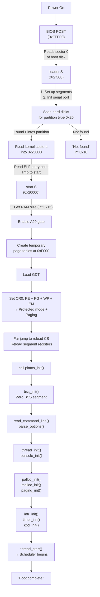
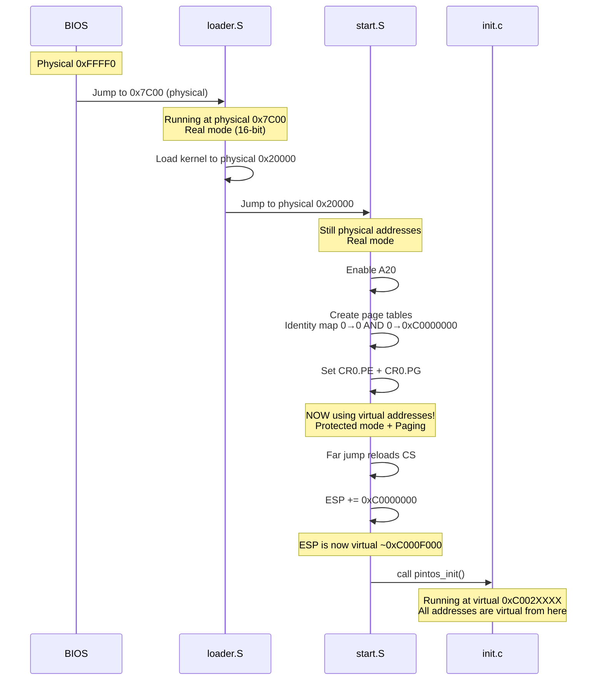

# The Boot Sequence — From Power On to Kernel

## 1. Executive Summary & Mental Model

When you press the power button, the CPU doesn't magically start running your OS. It goes through a **carefully choreographed sequence** — like a relay race where each runner (BIOS → Bootloader → Startup code → Kernel) hands the baton to the next.

**Real-world analogy**: Booting is like **opening a restaurant in the morning**:
1. **BIOS** = The building's automatic systems turn on (lights, ventilation) — hardware self-test
2. **Bootloader** (`loader.S`) = The manager arrives, finds the recipe book (kernel) on the shelf (disk), and carries it to the kitchen (memory)
3. **Startup code** (`start.S`) = The chef sets up the kitchen (protected mode, page tables)
4. **Kernel init** (`init.c`) = The chef begins cooking (initializes all subsystems, starts scheduling)

**Primary CS problems solved**:
- Transitioning from 16-bit real mode to 32-bit protected mode
- Setting up paging (virtual memory) from scratch
- Bootstrapping a complete OS from just 512 bytes of initial code

## 2. Theoretical Foundations

### x86 Boot Process

The Intel x86 CPU starts in **real mode** — a legacy 16-bit mode with no memory protection, no paging, and only 1 MB of addressable memory. The boot process must transition through these stages:

```
Real Mode (16-bit) → Protected Mode (32-bit) → Paging Enabled
   ↑                     ↑                        ↑
  BIOS +               start.S                 start.S
  loader.S            (sets CR0.PE)           (sets CR0.PG)
```

### Key x86 Concepts

| Concept | What It Is | Why It Matters |
|---|---|---|
| **Real Mode** | 16-bit mode, segment:offset addressing, 1 MB limit | CPU starts here; loader runs in it |
| **Protected Mode** | 32-bit mode, privilege rings, segmentation | Kernel runs here; enables memory protection |
| **A20 Gate** | Address line 20, historically tied low | Must enable to access memory above 1 MB |
| **GDT** | Global Descriptor Table — defines memory segments | Required for protected mode |
| **Page Table** | Maps virtual addresses to physical addresses | Enables kernel virtual memory at 0xC0000000 |
| **CR0** | Control Register 0 — enables PE, PG, WP | The "master switches" for protection and paging |
| **CR3** | Page Directory Base Register | Points CPU to the active page directory |

### Memory During Boot

```
Physical Address Space During Boot:

0x00000000  +-------------------+
            | IVT (Interrupt    |  Real mode interrupt vectors
            | Vector Table)     |
0x00000400  +-------------------+
            | BIOS Data Area    |
0x00007C00  +-------------------+
            | Bootloader        |  loader.S loaded here by BIOS (512 bytes)
0x00007E00  +-------------------+
            |                   |
0x0000F000  +-------------------+
            | Page Directory    |  Temporary page directory created by start.S
0x00010000  +-------------------+
            | Page Tables       |  Temporary page tables (16 pages for 64 MB)
0x00020000  +-------------------+
            | KERNEL            |  Kernel loaded here by loader (up to 512 KB)
            | (start.S, init.c, |
            |  thread.c, etc.)  |
0x000A0000  +-------------------+
            | VGA/BIOS ROM      |  Hardware reserved
0x00100000  +-------------------+
```

## 3. Architecture & Visual Topography

### Complete Boot Flow



## 4. Source Code Anatomy & Deep Dive

### Stage 1: `loader.S` — The Bootloader (512 bytes)

The BIOS loads this 512-byte code at physical address `0x7C00` and jumps to it.

**Key operations in order**:

1. **Set up segments** (lines 24-27): Initialize DS, SS, ESP for real-mode operation
2. **Configure serial port** (lines 31-34): For output even without VGA
3. **Scan for Pintos partition** (lines 50-98): 
   - Read MBR from each hard disk via `int 0x13` (BIOS disk read)
   - Check for MBR signature (`0xAA55` at offset 510)
   - Look for partition type `0x20` (Pintos kernel partition)
   - Check if partition is bootable (`0x80` flag)
4. **Load kernel** (lines 113-148):
   - Read up to 1024 sectors (512 KB) from the kernel partition
   - Load into physical address `0x20000` (128 KB)
   - Print dots as progress indicator every 16 sectors
5. **Jump to kernel** (lines 163-168):
   - Read ELF entry point from loaded image at offset `0x18`
   - Far jump (`ljmp`) to the kernel's `start` function

**The `read_sector` subroutine** (lines 230-246) uses **BIOS Extended Read** (`int 0x13`, function `0x42`) with a Disk Address Packet (DAP) pushed onto the stack.

### Stage 2: `start.S` — Real Mode to Protected Mode

This is the kernel's first code to run. It performs the critical transition:

1. **Get memory size** (lines 41-48): Uses `int 0x15` function `0x88`. Returns KB of memory above 1 MB. Capped at 64 MB. Stores result in `init_ram_pages`.

2. **Enable A20** (lines 53-78): Sends commands to the keyboard controller (port `0x64`/`0x60`) to enable the A20 address line. Without this, physical addresses above 1 MB wrap around to 0.

3. **Create page tables** (lines 84-124):
   - **Page directory** at physical `0xF000`: 1024 entries, initially zeroed
   - Creates identity mapping AND high mapping for first 64 MB:
     - Physical `0x00000000` → Virtual `0x00000000` (identity, for transition)
     - Physical `0x00000000` → Virtual `0xC0000000` (kernel virtual addresses)
   - **Page tables** at physical `0x10000`: One page per 4 MB of RAM

4. **Switch to protected mode** (lines 126-175):
   - Disable interrupts (`cli`) — no IDT set up yet
   - Load GDT descriptor (`lgdt`)
   - Set CR0 bits: PE (protect), PG (paging), WP (write protect), EM (FPU emulation)
   - Far jump to reload CS with kernel code segment selector (`0x08`)
   - Reload all data segment registers with kernel data selector (`0x10`)
   - Adjust ESP to use virtual address (add `LOADER_PHYS_BASE`)
   - Call `pintos_init()`

### Stage 3: `kernel.lds.S` — The Linker Script

Tells the linker where to place kernel sections in memory:

```
_start = 0xC0000000 + 0x20000 = 0xC0020000  (kernel virtual base)

.text    → Code (executable, read-only)
.rodata  → Read-only data (strings, constants)
.data    → Initialized data (global variables)
.bss     → Uninitialized data (zeroed at runtime by bss_init)

ASSERT: kernel must be ≤ 512 KB
```

### Stage 4: `init.c` — High-Level Kernel Initialization

`pintos_init()` is the kernel's "main" function. See the dedicated [init.c module](./04-init.md) for full-depth coverage.

## 5. Runtime Execution & Sequence

### Address Transition During Boot



## 6. Edge Cases, Failure Modes & Resilience

| Failure | Stage | What Happens |
|---|---|---|
| No bootable disk | BIOS | BIOS prints error, tries next device |
| No Pintos partition (type 0x20) | loader.S | Prints "Not found", calls `int 0x18` (BIOS: boot failed) |
| Disk read error | loader.S | Prints "Bad read", calls `int 0x18` |
| Kernel > 512 KB | Link time | Linker ASSERT fails: "Kernel image is too big" |
| < 1 MB RAM | start.S | `init_ram_pages` will be 0 or very small; `palloc_init` will fail |
| A20 enable fails | start.S | Memory above 1 MB wraps to 0; kernel data corrupted, crash |

## 7. Hands-On Verification & Challenges

<details>
<summary><strong>Q1: Why does start.S create BOTH an identity mapping and a high mapping in the page tables?</strong></summary>

When paging is first enabled (CR0.PG = 1), the CPU is executing code at physical address ~0x20000. If only the high mapping (0xC0000000+) existed, the very next instruction fetch at physical ~0x20000 would page fault because there's no mapping for it. The identity mapping allows the currently executing code to continue working. Once the far jump reloads CS and execution moves to the high virtual addresses, the identity mapping is no longer needed (but it's harmless to keep it).
</details>

<details>
<summary><strong>Q2: Why is the A20 gate enabled via the keyboard controller?</strong></summary>

This is a historical accident from the IBM AT. The original IBM PC (8088) had only 20 address lines, so address line A20 didn't exist. When the 80286 added it, IBM wired the A20 line through the keyboard controller so that it could be disabled for backward compatibility with 8088 software that relied on address wraparound. Every x86 machine since has preserved this bizarre arrangement for compatibility.
</details>

<details>
<summary><strong>Q3: What would happen if you forgot to call <code>cli</code> before loading the GDT and enabling protected mode?</strong></summary>

An interrupt could fire during the transition. Since the IDT (Interrupt Descriptor Table) hasn't been set up yet, the CPU would triple-fault (fault while handling a fault while handling a fault) and reset. The `cli` instruction prevents this by disabling interrupts until the IDT is configured later in `intr_init()`.
</details>

**Challenge (P0 Debugging)**: Use GDB to trace the boot sequence:
1. Set a breakpoint at `0x7C00` and examine the first bootloader instruction
2. Step through `loader.S` and identify which BIOS interrupt reads disk sectors
3. Set a breakpoint at `pintos_init` and examine `init_page_dir[pd_no(ptov(0))]`

## 8. Lab Modifications Guide

This module covers the boot sequence code. **None of these files are modified in any lab**, but understanding them is essential for:

| Lab | Why This Matters |
|---|---|
| P0 | GDB debugging exercise traces through `loader.S`, `start.S`, and into `pintos_init()`. You need to answer questions about the first instruction, BIOS interrupts used, and memory values at specific points. |
| P1 | Understanding that `timer_init()` happens in `pintos_init()` helps you see where `timer_sleep()` fits in the initialization order. |
| P2 | Understanding that `#ifdef USERPROG` guards in `init.c` control which subsystems are initialized when building from `userprog/`. |
