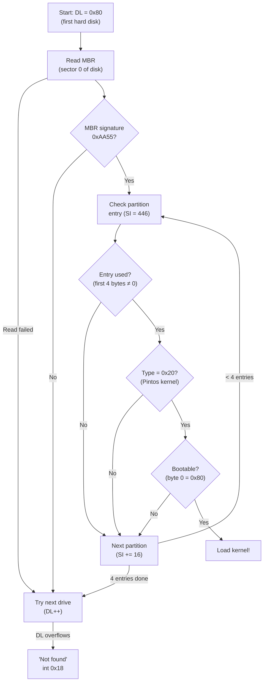
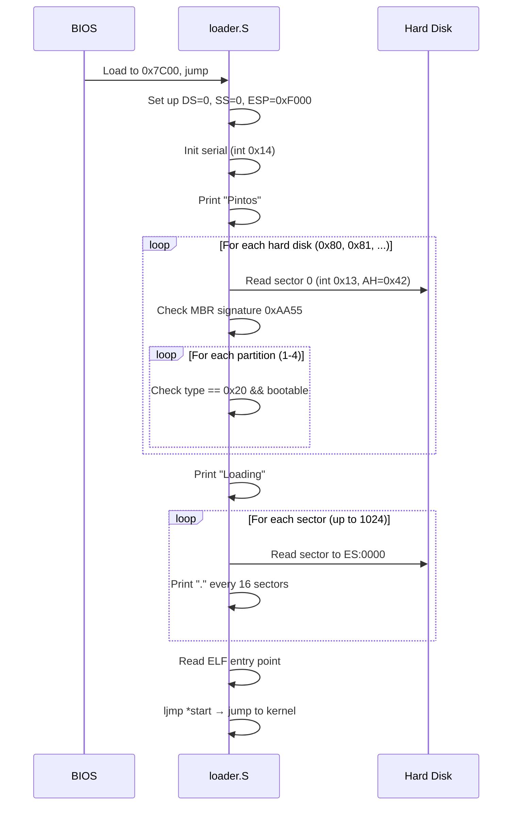

# The Bootloader — loader.S & loader.h

## 1. Executive Summary & Mental Model

The bootloader is the **first Pintos code** that executes. It's a tiny 512-byte program that the BIOS loads from the first sector of the hard disk into memory at physical address `0x7C00`. Its sole job: **find the kernel on disk and load it into memory**.

**Analogy**: The bootloader is like a **delivery driver** who picks up a package (kernel) from a warehouse (disk) and delivers it to an address (memory at `0x20000`).

The bootloader runs in **16-bit real mode** — it can't use any C library, has no memory protection, and communicates with hardware only through BIOS interrupts.

## 2. Theoretical Foundations

### The 512-Byte Constraint

The BIOS loads exactly **one sector** (512 bytes) from the boot disk. The last 2 bytes must be `0xAA55` (the boot signature). The remaining 510 bytes must contain all the code AND data for:
- Serial port initialization
- Partition table scanning (4 entries × 16 bytes = 64 bytes reserved)
- Disk reading
- ELF entry point extraction
- String printing
- Command-line storage (128 bytes reserved)

### BIOS Disk Read: Extended Read (int 0x13, AH=0x42)

The bootloader uses the **Extended Read** function, which supports LBA (Logical Block Addressing) rather than legacy CHS (Cylinder-Head-Sector). It works by pushing a **Disk Address Packet (DAP)** onto the stack:

| Offset | Size | Value | Purpose |
|---|---|---|---|
| 0 | 1 | 16 | Packet size |
| 2 | 2 | 1 | Number of sectors to read |
| 4 | 4 | ES:0000 | Buffer address (segment:offset) |
| 8 | 4 | EBX | LBA sector number [0:31] |
| 12 | 4 | 0 | LBA sector number [32:63] |

## 3. Architecture & Visual Topography

### Loader Memory Layout

The 512-byte loader has a precise internal layout defined by `.org` directives:

```
Offset 0x000: Code (bootloader logic)
    ...
Offset 0x1B4: LOADER_ARG_CNT  (4 bytes — argument count)
Offset 0x1B8: LOADER_ARGS     (128 bytes — command-line args, written by pintos script)
Offset 0x1BE: LOADER_PARTS    (64 bytes — partition table, 4 × 16 bytes)
Offset 0x1FE: LOADER_SIG      (2 bytes — 0xAA55 boot signature)
```

### Partition Scanning Flow



## 4. Source Code Anatomy & Deep Dive

### `loader.h` — Constants

Key constants that define the loader's layout:

| Constant | Value | Purpose |
|---|---|---|
| `LOADER_BASE` | `0x7C00` | Physical address where BIOS loads the bootloader |
| `LOADER_END` | `0x7E00` | End of bootloader (512 bytes later) |
| `LOADER_KERN_BASE` | `0x20000` | Physical address where kernel is loaded (128 KB) |
| `LOADER_PHYS_BASE` | `0xC0000000` | Kernel virtual address base (3 GB) |
| `SEL_KCSEG` | `0x08` | Kernel code segment selector (GDT entry 1) |
| `SEL_KDSEG` | `0x10` | Kernel data selector (GDT entry 2) |

### Key Subroutines

**`puts` (line 185)**: An unusual subroutine that reads its string argument from the **instruction stream** — the string is placed immediately after the `call puts` instruction. After printing, it returns to the byte after the null terminator. This saves precious bytes compared to passing a pointer.

**`putc` (line 205)**: Outputs a character to both VGA (via `int 0x10`) and serial port (via `int 0x14`). Automatically adds `\n` after `\r`.

**`read_sector` (line 230)**: Builds a DAP on the stack and calls `int 0x13` function `0x42`. Returns with carry flag set on error.

### Kernel Loading

The loader reads the kernel partition's starting sector and size from the partition table entry at `ES:SI`:
- `ES:8(SI)` → starting LBA sector
- `ES:12(SI)` → partition size in sectors (capped at 1024 = 512 KB)

It loads sectors sequentially, advancing ES by `0x20` (512 bytes ÷ 16 = segment increment for one sector).

### Jumping to the Kernel

```asm
mov $0x2000, %ax       ; ES = 0x2000 → physical 0x20000
mov %ax, %es
mov %es:0x18, %dx      ; Read ELF entry point from offset 0x18 in ELF header
mov %dx, start         ; Store low 16 bits of entry point
movw $0x2000, start+2  ; Segment = 0x2000
ljmp *start            ; Far jump to segment:offset
```

The ELF header's `e_entry` field (at offset `0x18`) contains the entry point address. In Pintos, this points to `start` in `start.S`.

## 5. Runtime Execution & Sequence



## 6. Edge Cases, Failure Modes & Resilience

| Failure | What Happens | Recovery |
|---|---|---|
| No hard disk | `int 0x13` returns carry set | Loader prints "Not found", calls `int 0x18` |
| Disk has no MBR signature | `cmpw $0xaa55` fails | Skips to next drive |
| No Pintos partition (type 0x20) | All 4 entries checked, none match | Moves to next drive |
| Partition not bootable | `cmpb $0x80` fails | Moves to next partition |
| Sector read fails | Carry flag set | Prints "Bad read", halts |
| Serial port timeout | `int 0x14` sets bit 7 of AH | Self-modifying code: patches `int $0x14` → `NOP NOP` |

## 7. Hands-On Verification & Challenges

<details>
<summary><strong>Q1 (P0): How does the bootloader read disk sectors? What BIOS interrupt is used?</strong></summary>

It uses `int 0x13` with function `AH = 0x42` (Extended Read). The function takes a Disk Address Packet (DAP) on the stack containing the LBA sector number, buffer address, and sector count. See the `read_sector` subroutine at line 230 of `loader.S`.
</details>

<details>
<summary><strong>Q2 (P0): How does the bootloader decide whether it found the Pintos kernel?</strong></summary>

It checks two conditions in each partition table entry: (1) the partition type byte at offset 4 must equal `0x20` (Pintos kernel type), and (2) the first byte must equal `0x80` (bootable flag).
</details>

<details>
<summary><strong>Q3 (P0): At what point does the bootloader transfer control to the kernel?</strong></summary>

After loading all kernel sectors into memory at 0x20000, it reads the ELF entry point from offset 0x18 of the ELF header, stores it as a segment:offset far pointer, and executes `ljmp *start` to jump to it.
</details>

## 8. Lab Modifications Guide

This file is **not modified in any lab**. However, the P0 debugging exercise requires you to:
- Set a breakpoint at `0x7C00` and trace through the bootloader in GDB
- Answer specific questions about BIOS interrupts and partition scanning
- Compare `loader.S` source with `build/loader.asm` disassembly
