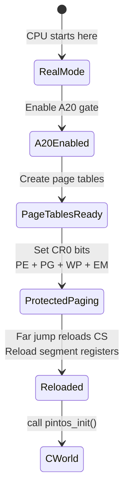

# Kernel Startup — start.S

## 1. Executive Summary & Mental Model

`start.S` is the **bridge between the 1980s and the modern world**. When the bootloader jumps here, the CPU is still in 16-bit real mode with no memory protection and only 1 MB of addressable memory. By the time `start.S` finishes, the CPU is in 32-bit protected mode with paging enabled and the kernel mapped at virtual address `0xC0000000`.

**Analogy**: `start.S` is like **converting a horse-drawn carriage into a car** while it's moving. You replace the engine (real mode → protected mode), add GPS (paging), and install seatbelts (write protection) — all without stopping.

## 2. Theoretical Foundations

### The Mode Transition



### Why Each Step Is Needed

| Step | Without It... |
|---|---|
| Enable A20 | Addresses above 1 MB wrap to 0 — kernel at 0x20000+ would be inaccessible correctly |
| Create page tables | Paging can't be enabled without valid tables — CPU would triple-fault |
| Identity map low memory | After enabling paging, the next instruction fetch (still at physical ~0x20000) would page fault |
| Map at 0xC0000000 | Kernel C code expects to run at virtual 0xC0000000+ (set by linker script) |
| Load GDT | Protected mode requires valid segment descriptors — CPU would fault |
| Far jump after PE | CS still caches the real-mode segment descriptor — must reload it |
| Set WP bit | Without it, kernel code could accidentally write to read-only pages |
| Set EM bit | Without it, FPU instructions would silently use stale FPU state from another thread |

## 3. Architecture & Visual Topography

### Page Table Structure Created by start.S

```
Page Directory (at physical 0xF000):
  Entry 0:   → Page Table at 0x10000  (maps 0x00000000-0x003FFFFF)
  Entry 1:   → Page Table at 0x11000  (maps 0x00400000-0x007FFFFF)
  ...
  Entry 15:  → Page Table at 0x1F000  (maps 0x03C00000-0x03FFFFFF)
  Entry 768: → Page Table at 0x10000  (maps 0xC0000000-0xC03FFFFF)  ← Same tables!
  Entry 769: → Page Table at 0x11000  (maps 0xC0400000-0xC07FFFFF)
  ...
  Entry 783: → Page Table at 0x1F000  (maps 0xFC000000-0xFBFFFFFF)

Key: Entry N maps virtual [N×4MB, (N+1)×4MB)
     Entry 768 = LOADER_PHYS_BASE >> 22 = 0xC0000000 >> 22 = 768
```

Both identity mapping (entry 0-15) and kernel mapping (entry 768-783) point to the **same** page tables — the physical memory is accessible at two virtual addresses simultaneously.

## 4. Source Code Anatomy & Deep Dive

### Phase 1: Memory Size Detection (lines 41-48)

```asm
movb $0x88, %ah       ; BIOS function: get extended memory size
int $0x15             ; Returns AX = KB above 1MB
addl $1024, %eax      ; Add the first 1MB
cmp $0x10000, %eax    ; Cap at 64 MB (0x10000 KB)
jbe 1f
mov $0x10000, %eax
1: shrl $2, %eax         ; Convert KB to 4KB pages (divide by 4)
   addr32 movl %eax, init_ram_pages - LOADER_PHYS_BASE - 0x20000
```

The result is stored in `init_ram_pages` — but since we haven't enabled paging yet, the address must be calculated manually by subtracting the virtual base and the kernel load offset.

### Phase 2: A20 Gate (lines 53-78)

The A20 gate is controlled through the **keyboard controller** (ports `0x64` and `0x60`):

```asm
; Wait for keyboard controller to be ready
1: inb $0x64, %al
   testb $0x2, %al      ; Bit 1 = input buffer full?
   jnz 1b               ; If busy, keep polling

; Send "write output port" command
   movb $0xd1, %al
   outb %al, $0x64

; Wait again
1: inb $0x64, %al
   testb $0x2, %al
   jnz 1b

; Enable A20 (bit 1 of output port)
   movb $0xdf, %al       ; 0xDF = all bits set except bit 5 (reserved)
   outb %al, $0x60       ; Bit 1 enables A20
```

### Phase 3: The Big Switch (lines 126-175)

```asm
cli                    ; Disable interrupts — no IDT yet!

lgdt gdtdesc           ; Load GDT register

movl %cr0, %eax
orl $CR0_PE | CR0_PG | CR0_WP | CR0_EM, %eax
movl %eax, %cr0       ; ← THE MOMENT: protected mode + paging enabled

ljmp $SEL_KCSEG, $1f  ; Far jump: reload CS with kernel code selector

.code32               ; Tell assembler: 32-bit mode from here

1: mov $SEL_KDSEG, %ax  ; Reload all data segments
   mov %ax, %ds
   mov %ax, %es
   mov %ax, %fs
   mov %ax, %gs
   mov %ax, %ss
   addl $LOADER_PHYS_BASE, %esp  ; Adjust stack to virtual address
   movl $0, %ebp                  ; Null-terminate backtrace chain
   call pintos_init               ; Enter C world!
```

### The GDT (lines 190-197)

```asm
gdt:
  .quad 0x0000000000000000   ; Entry 0: Null descriptor (required)
  .quad 0x00cf9a000000ffff   ; Entry 1 (SEL_KCSEG=0x08): Kernel code
  .quad 0x00cf92000000ffff   ; Entry 2 (SEL_KDSEG=0x10): Kernel data
```

Both code and data segments span the entire 4 GB address space (base=0, limit=0xFFFFF with 4KB granularity). This is a **flat memory model** — segmentation is effectively disabled; all addressing goes through paging.

## 5. Runtime Execution & Sequence

The entire `start.S` runs as a **single function call** — no threading, no interrupts. It executes linearly from the bootloader's jump until `call pintos_init()`.

## 6. Edge Cases, Failure Modes & Resilience

| Issue | Risk | Mitigation |
|---|---|---|
| A20 controller hangs | Infinite loop at `inb $0x64` | None — boot hangs. Some machines need alternative A20 methods |
| Page tables at 0xF000 conflict with stack | Stack was at 0xF000 in loader | By this point the stack is still there but the page table zeroing overwrites it — the code doesn't use the stack during this phase |
| Interrupt fires during mode switch | Triple fault (no IDT) | `cli` disables interrupts before the switch |

## 7. Hands-On Verification & Challenges

<details>
<summary><strong>Q1: Why does start.S set both PE and PG simultaneously instead of enabling protected mode first, then paging?</strong></summary>

Intel allows enabling both in a single `mov` to CR0. Setting them separately would require a valid IDT between the two steps (an interrupt could fire). By setting both at once, the CPU transitions directly to protected-mode-with-paging in one step. The identity mapping ensures the next instruction is still fetchable.
</details>

<details>
<summary><strong>Q2: Why is <code>movl $0, %ebp</code> needed?</strong></summary>

GDB and the `backtrace` function walk the chain of `EBP` frame pointers to generate call stack traces. Setting EBP to 0 provides a termination condition — the backtrace stops when it hits a null frame pointer. Without this, it would follow garbage pointers and crash or print nonsense.
</details>

## 8. Lab Modifications Guide

This file is **not modified in any lab**. For P0, you trace through it with GDB to understand the real-to-protected mode transition.
