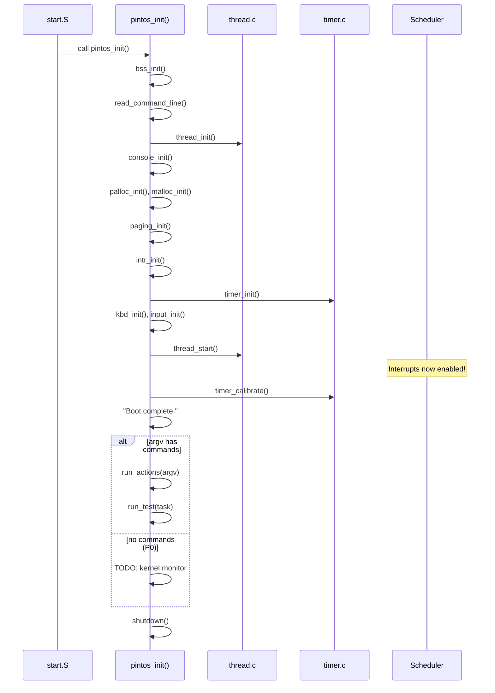

# Kernel Initialization — init.c & init.h ⭐ P0

## 1. Executive Summary & Mental Model

`init.c` is the **"main" program of the Pintos kernel**. After the assembly startup code (`start.S`) sets up protected mode and paging, it calls `pintos_init()` — the single C function that bootstraps every subsystem in the correct order.

**Real-world analogy**: `pintos_init()` is like a **startup checklist for a space station**:
1. ✅ Clear residual data (BSS init)
2. ✅ Read mission parameters (command line)
3. ✅ Activate life support (thread system)
4. ✅ Turn on communications (console)
5. ✅ Power up systems (memory, interrupts, devices)
6. ✅ Begin operations (run tests or start user programs)

The **order matters** — you can't use `printf` before `console_init()`, and you can't allocate memory before `palloc_init()`.

**Primary CS problems solved**:
- Correct initialization ordering of interdependent subsystems
- Transitioning from bare hardware to a fully functional OS
- Parsing kernel boot parameters

## 2. Theoretical Foundations

### Initialization Ordering Problem

In an OS kernel, subsystems depend on each other. The initialization must be **topologically sorted** according to these dependencies:


### BSS Segment

The **BSS** (Block Started by Symbol) is the section of memory for **uninitialized global and static variables**. In C, these are guaranteed to start as zero. However, the ELF binary doesn't store actual zeros (waste of disk space) — it just records the segment's boundaries. The kernel must **zero this memory at runtime**.

## 3. Architecture & Visual Topography

### `init.h` — The Header

```c
#ifndef THREADS_INIT_H
#define THREADS_INIT_H
#include <debug.h>
#include <stdbool.h>
#include <stddef.h>
#include <stdint.h>

/* Page directory with kernel mappings only. */
extern uint32_t *init_page_dir;
#endif
```

This header exports exactly one symbol: `init_page_dir` — the kernel's base page directory. Used by `paging_init()` and later by `pagedir_create()` to clone kernel mappings into user process page directories.

### Conditional Compilation in init.c

`init.c` uses `#ifdef` guards to include subsystem-specific code only when building for the right project:

| Guard | When Defined | What It Enables |
|---|---|---|
| `#ifdef USERPROG` | Building from `userprog/` or `vm/` or `filesys/` | GDT, TSS, exception handler, syscall handler, user page limit |
| `#ifdef FILESYS` | Building from `userprog/` or `filesys/` | File system init, block device discovery, format option |
| `#ifdef VM` | Building from `vm/` | Swap device configuration |

When building from `threads/` (P0/P1), **none** of these are defined, so `init.c` only initializes the base kernel: threads, devices, and the shared library.

## 4. Source Code Anatomy & Deep Dive

### Global Variables

```c
uint32_t *init_page_dir;          // Kernel page directory (exported via init.h)

#ifdef FILESYS
static bool format_filesys;        // -f flag: format file system?
static const char *filesys_bdev_name;   // Override file system block device
static const char *scratch_bdev_name;   // Override scratch block device
#ifdef VM
static const char *swap_bdev_name;      // Override swap block device
#endif
#endif

static size_t user_page_limit = SIZE_MAX;  // -ul flag: cap user memory
```

### `pintos_init()` — Line-by-Line Walkthrough

```c
int pintos_init (void)     // NO_RETURN: this function never returns
{
  char **argv;

  /* 1. Clear BSS — zero all uninitialized global/static variables */
  bss_init ();
```
**Why first?** All later code assumes globals start at zero. Without this, `init_page_dir` might contain garbage.

```c
  /* 2. Read and parse kernel command line */
  argv = read_command_line ();    // Reads args from bootloader data area
  argv = parse_options (argv);    // Processes -q, -f, -mlfqs, -rs, etc.
```
**Note**: `read_command_line()` reads from physical memory written by the `pintos` script into the bootloader image. The args live at physical address `LOADER_ARGS` (defined in `loader.h`).

```c
  /* 3. Initialize thread system and console */
  thread_init ();      // Creates initial thread struct, init ready list
  console_init ();     // Enables console locking for thread-safe printf
```
**Critical order**: `thread_init()` must come before `console_init()` because the console uses locks, which require an initialized thread system.

```c
  /* 4. Print greeting — printf is now safe to use */
  printf ("Pintos booting with %'"PRIu32" kB RAM...\n",
          init_ram_pages * PGSIZE / 1024);
```

```c
  /* 5. Initialize memory system */
  palloc_init (user_page_limit);  // Page allocator: divides RAM into pages
  malloc_init ();                  // Block allocator: subdivides pages
  paging_init ();                  // Create permanent kernel page tables
```
**Order matters**: `palloc_init()` must come first because `malloc_init()` uses `palloc_get_page()` internally, and `paging_init()` uses both.

```c
  /* 6. Protected mode setup (P2 only) */
#ifdef USERPROG
  tss_init ();    // Task State Segment — for kernel stack on privilege change
  gdt_init ();    // Global Descriptor Table — adds user code/data segments
#endif
```

```c
  /* 7. Initialize interrupt handlers */
  intr_init ();       // Set up IDT (Interrupt Descriptor Table)
  timer_init ();      // Configure PIT for 100 Hz ticks
  kbd_init ();        // Register keyboard interrupt handler
  input_init ();      // Initialize input buffer
#ifdef USERPROG
  exception_init ();  // Register page fault, GPF handlers
  syscall_init ();    // Register int 0x30 handler
#endif
```

```c
  /* 8. Start scheduler and calibrate timer */
  thread_start ();         // Creates idle thread, enables interrupts
  serial_init_queue ();    // Switch serial to interrupt-driven mode
  timer_calibrate ();      // Measure CPU speed for accurate delays
```
**Key moment**: `thread_start()` calls `intr_enable()`, enabling interrupts for the first time. From this point on, timer ticks will fire and context switches can happen.

```c
  /* 9. Initialize file system (P2+ only) */
#ifdef FILESYS
  ide_init ();                      // Detect IDE disks
  locate_block_devices ();          // Assign disks to roles
  filesys_init (format_filesys);    // Mount or format file system
#endif
```

```c
  /* 10. Boot complete — run actions or kernel monitor */
  printf ("Boot complete.\n");

  if (*argv != NULL) {
    run_actions (argv);     // Execute commands from kernel command line
  } else {
    // TODO: no command line passed to kernel. Run interactively  ← P0 GOES HERE
  }

  /* 11. Cleanup and shutdown */
  shutdown ();
  thread_exit ();
}
```

### `bss_init()` — Zero the BSS

```c
static void bss_init (void) 
{
  extern char _start_bss, _end_bss;         // Defined by kernel.lds.S
  memset (&_start_bss, 0, &_end_bss - &_start_bss);  // Fill with zeros
}
```
The linker script defines `_start_bss` and `_end_bss` symbols marking the BSS boundaries. This function zeros everything between them.

### `paging_init()` — Create Permanent Page Tables

```c
static void paging_init (void)
{
  uint32_t *pd, *pt;
  size_t page;
  extern char _start, _end_kernel_text;

  pd = init_page_dir = palloc_get_page (PAL_ASSERT | PAL_ZERO);  // Allocate page directory
  pt = NULL;
  for (page = 0; page < init_ram_pages; page++)
    {
      uintptr_t paddr = page * PGSIZE;          // Physical address of this page
      char *vaddr = ptov (paddr);                // Convert to virtual: paddr + 0xC0000000
      size_t pde_idx = pd_no (vaddr);            // Page directory index (top 10 bits)
      size_t pte_idx = pt_no (vaddr);            // Page table index (middle 10 bits)
      bool in_kernel_text = &_start <= vaddr && vaddr < &_end_kernel_text;

      if (pd[pde_idx] == 0)                      // Need a new page table?
        {
          pt = palloc_get_page (PAL_ASSERT | PAL_ZERO);
          pd[pde_idx] = pde_create (pt);         // Point PDE to new page table
        }

      pt[pte_idx] = pte_create_kernel (vaddr, !in_kernel_text);
      // Kernel text is read-only (!writable), data is writable
    }

  asm volatile ("movl %0, %%cr3" : : "r" (vtop (init_page_dir)));
  // Load new page directory into CR3, replacing the temporary one from start.S
}
```

This replaces the temporary page tables from `start.S` with permanent ones that:
- Map **only** kernel virtual addresses (0xC0000000+), not identity-mapped
- Mark kernel **text** (code) as read-only
- Mark kernel **data** as writable

### `run_actions()` — Command Dispatch

```c
static void run_actions (char **argv) 
{
  struct action {
    char *name;
    int argc;
    void (*function) (char **argv);
  };

  static const struct action actions[] = {
    {"run", 2, run_task},       // "run <test-name>" → run_task()
#ifdef FILESYS
    {"ls", 1, fsutil_ls},       // "ls" → list files
    {"cat", 2, fsutil_cat},     // "cat <file>" → print file contents
    {"rm", 2, fsutil_rm},       // "rm <file>" → delete file
    {"extract", 1, fsutil_extract},
    {"append", 2, fsutil_append},
#endif
    {NULL, 0, NULL},
  };
  // ... iterates through argv, matches action names, calls functions
}
```

### `run_task()` — Execute a Test or User Program

```c
static void run_task (char **argv)
{
  const char *task = argv[1];
  printf ("Executing '%s':\n", task);
#ifdef USERPROG
  process_wait (process_execute (task));   // P2: load and run user program
#else
  run_test (task);                          // P0/P1: run a kernel test
#endif
  printf ("Execution of '%s' complete.\n", task);
}
```

## 5. Runtime Execution & Sequence

### P0/P1 Boot Sequence (threads project)



## 6. Edge Cases, Failure Modes & Resilience

| Scenario | What Happens | Defense |
|---|---|---|
| `palloc_init()` called before `bss_init()` | Free page bitmap contains garbage → random pages marked as used/free | Init order enforced by sequential code |
| Command line exceeds 128 bytes | `LOADER_ARGS_LEN` is 128 → PANIC in `read_command_line()` | Checked with bounds: `if (p >= end) PANIC(...)` |
| Unknown command-line option | `PANIC ("unknown option...")` | Validated in `parse_options()` |
| Unknown action name | `PANIC ("unknown action...")` | Validated in `run_actions()` |
| `paging_init()` allocates too many page tables | Uses `PAL_ASSERT` → kernel panics if out of memory | Limited to 64 MB RAM → at most 16 page table pages |

## 7. Hands-On Verification & Challenges

<details>
<summary><strong>Q1: Why does <code>pintos_init()</code> call <code>thread_init()</code> before <code>console_init()</code>?</strong></summary>

`console_init()` initializes the console lock (used to prevent interleaved printf output). Locks require a valid thread context — `lock_acquire()` calls `thread_current()`, which only works after `thread_init()` converts the running code into a proper thread structure.
</details>

<details>
<summary><strong>Q2: Why does the kernel call <code>timer_calibrate()</code> AFTER <code>thread_start()</code>?</strong></summary>

`timer_calibrate()` measures CPU speed by counting iterations in a loop, using timer ticks as a reference. Timer ticks are delivered via interrupts, which aren't enabled until `thread_start()` calls `intr_enable()`. If called earlier, the calibration would hang forever waiting for a tick that never comes.
</details>

<details>
<summary><strong>Q3: What's the difference between <code>run_test()</code> and <code>process_execute()</code>?</strong></summary>

In P0/P1 (threads project, no `USERPROG`), `run_test()` runs test code **directly in the kernel** — it calls C functions. In P2 (`USERPROG` defined), `process_execute()` loads an ELF binary from the file system and runs it as a **user-space process** with its own address space and restricted privileges.
</details>

## 8. Lab Modifications Guide

### ⭐ P0: Adding a Kernel Monitor

**Task**: When no command-line arguments are passed, instead of doing nothing, run an interactive shell.

**Location**: Line 136 of `init.c`, the `else` branch:
```c
  } else {
    // TODO: no command line passed to kernel. Run interactively
  }
```

**What to implement**: A simple read-eval-print loop:
1. Print prompt `CS318> `
2. Read characters with `input_getc()` until newline
3. Parse the input:
   - `"whoami"` → print your name
   - `"exit"` → break out of loop (let kernel shutdown)
   - anything else → print `"invalid command"`
4. Repeat

#### Option A: Simple Character-by-Character Read (Recommended)

```c
// Replace the TODO comment with something like:
#define BUF_SIZE 128
char buf[BUF_SIZE];
while (true) {
    printf("CS318> ");
    // Read input character by character
    int i = 0;
    while (i < BUF_SIZE - 1) {
        char c = input_getc();
        if (c == '\r' || c == '\n') {
            printf("\n");
            break;
        }
        putchar(c);          // Echo character
        buf[i++] = c;
    }
    buf[i] = '\0';

    // Parse command
    if (strcmp(buf, "whoami") == 0)
        printf("Your Name Here\n");
    else if (strcmp(buf, "exit") == 0)
        break;
    else if (i > 0)
        printf("invalid command\n");
}
```

**Pros**: Simple, matches lab requirements exactly.  
**Cons**: No command history, no line editing (backspace doesn't work properly).

#### Option B: With Backspace Support

Extend Option A by handling the backspace character (`'\b'` or ASCII 127):

```c
if (c == '\b' || c == 127) {   // Backspace
    if (i > 0) {
        i--;
        printf("\b \b");       // Erase character on screen
    }
    continue;
}
```

**Pros**: Better user experience.  
**Cons**: Slightly more code; not strictly required.

#### Key Functions to Use

| Function | Header | Purpose |
|---|---|---|
| `input_getc()` | `devices/input.h` | Blocks until keyboard input, returns char |
| `printf()` | `stdio.h` | Formatted output to console |
| `putchar()` | `stdio.h` | Output a single character |
| `strcmp()` | `string.h` | Compare two strings |
| `shutdown_power_off()` | `devices/shutdown.h` | Power off (for potential "halt" command) |

#### Invariants to Preserve

- Do **not** call `thread_exit()` from the monitor — let the natural flow reach it after the `else` block
- The `shutdown()` call after the if/else block will handle clean shutdown
- Make sure your buffer is on the stack (local variable), not a global, to avoid BSS issues

#### Related P0 Questions

The P0 lab also asks you to answer GDB debugging questions about:
- The first BIOS instruction (at `0xFFFF0`)
- How `loader.S` reads disk sectors (answer: `int 0x13`, function `0x42`)
- Values of `init_page_dir[pd_no(ptov(0))]` at various points during `pintos_init()`
- Call stacks when `palloc_get_page()` is called

These require understanding `init.c`'s initialization sequence and using GDB breakpoints, not code modifications.
