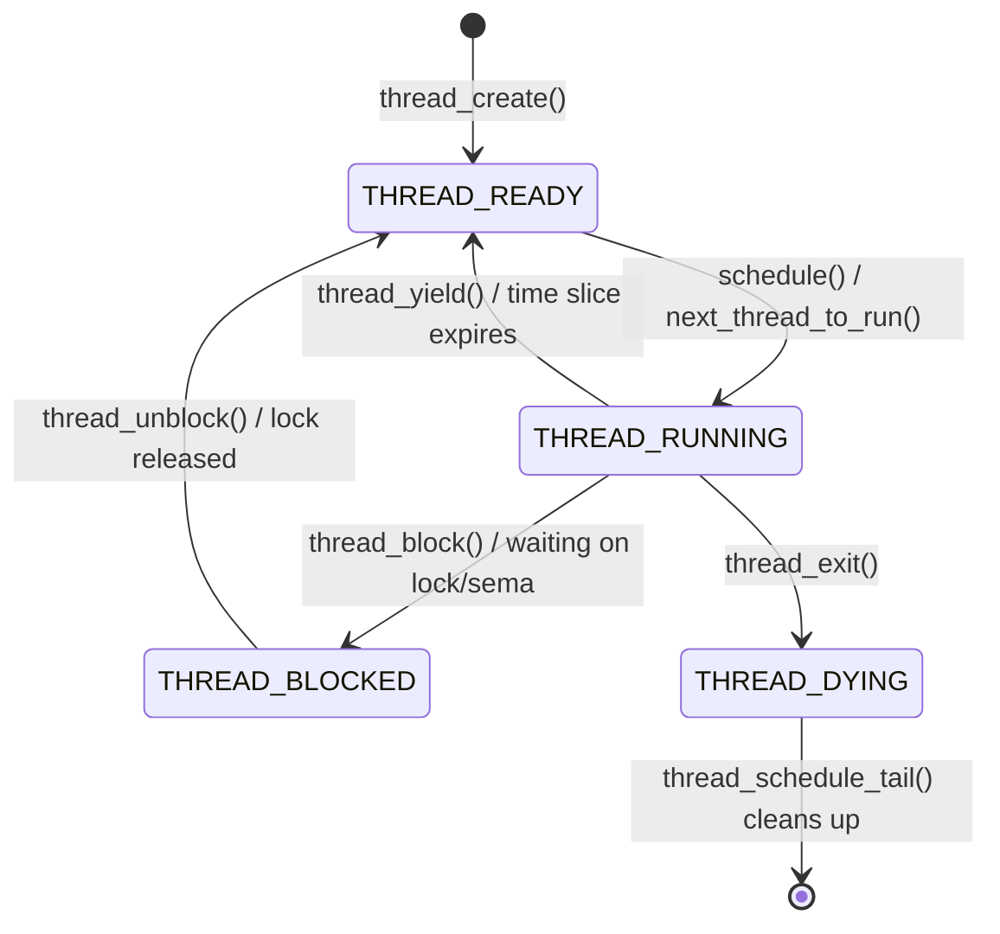
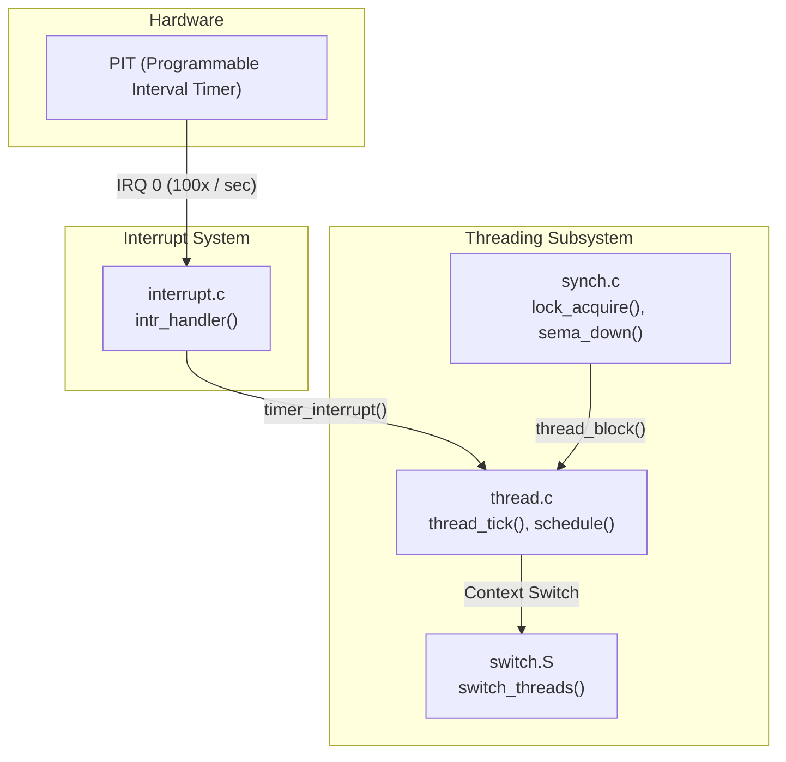
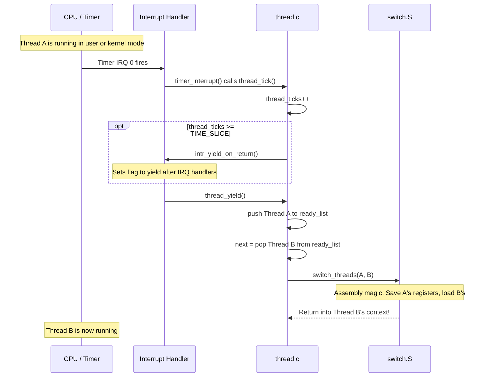

# Threading Subsystem — Architecture & Overview

## 1. Executive Summary & Mental Model

The threading subsystem is the **heart of the Pintos kernel**. It is responsible for giving each thread the illusion that it has exclusive access to the CPU, even though many threads may be active. It decides *who* runs, *when* they run, and *how* they safely share resources.

**Real-world analogy**: The threading system is like the **manager of a busy restaurant kitchen**:
- The **CPU** is the single stove.
- The **threads** are the chefs trying to cook their dishes.
- The **scheduler** (manager) tells chefs when it's their turn to use the stove and when they have to step aside.
- **Synchronization primitives** (locks, semaphores) are the rules preventing two chefs from grabbing the same pan at the same time.

**Primary CS problems solved**:
- **Multiplexing**: Sharing a single CPU among multiple execution contexts.
- **Concurrency control**: Ensuring predictable behavior when multiple threads access shared data.
- **Fairness and Priority**: Ensuring important tasks get CPU time before less important ones.

## 2. Theoretical Foundations

### Preemptive Scheduling

Pintos uses **preemptive scheduling**. A thread doesn't have to explicitly yield the CPU (though it can). Instead, a hardware timer generates interrupts at regular intervals (ticks). The timer interrupt handler calls `thread_tick()`, which tracks how long the current thread has been running. If its time slice (quantum) expires, the scheduler forcibly preempts it and switches to another thread.

### The Round-Robin Scheduler (Default)

Out of the box, Pintos uses a simple **Round-Robin (RR)** scheduler:
- All ready threads are placed in a FIFO queue (`ready_list`).
- The running thread executes for a fixed time slice (`TIME_SLICE = 4` ticks).
- When preempted, it goes to the back of the queue, and the thread at the front gets the CPU.
- **Priority is ignored** in the base Pintos implementation.

### Priority Scheduling & MLFQS (Project 1 Goals)

For Project 1, you will replace the round-robin scheduler with:
1. **Strict Priority Scheduling**: The highest priority ready thread *always* runs. If a higher-priority thread becomes ready, the running thread must yield immediately.
2. **Priority Donation**: To solve priority inversion (when a high-priority thread waits on a lock held by a low-priority thread).
3. **Multi-Level Feedback Queue (MLFQS)**: An advanced scheduler that dynamically adjusts priorities based on CPU usage to balance fairness and responsiveness.

## 3. Architecture & Visual Topography

### Thread State Machine

Every thread in Pintos is in exactly one of these four states, defined in `enum thread_status`:

### Subsystem Interaction

## 4. Source Code Anatomy & Deep Dive

### The Core Files

1. **`thread.c / thread.h`**: The main interface. Defines `struct thread`, creation, destruction, blocking, unblocking, and the scheduler queue (`ready_list`).
2. **`switch.S / switch.h`**: The low-level assembly routine that performs the actual context switch by saving the old thread's registers and loading the new one's.
3. **`synch.c / synch.h`**: Synchronization primitives (Semaphores, Locks, Condition Variables) built on top of `thread_block()` and `thread_unblock()`.

### The `ready_list` and `all_list`

- **`ready_list`**: A linked list containing only threads in the `THREAD_READY` state. Managed by the scheduler.
- **`all_list`**: A linked list containing *all* threads in the system (ready, running, blocked), except dying ones. Useful for MLFQS calculations where every thread's properties must be updated simultaneously.

## 5. Runtime Execution & Sequence

### The Anatomy of a Preemption

What exactly happens when a time slice expires?

## 6. Edge Cases, Failure Modes & Resilience

| Scenario | Consequence | Pintos Defense |
|---|---|---|
| Interrupt fires while manipulating `ready_list` | List corruption (race condition) | Scheduler functions (`schedule`, `thread_block`, `thread_unblock`) require interrupts to be **disabled** (`INTR_OFF`). |
| Thread tries to block inside an interrupt handler | Deadlock / Kernel Panic | `thread_block()` checks `ASSERT(!intr_context())`. Interrupt handlers cannot block. |
| Stack grows too large | Overwrites `struct thread` | `thread_current()` checks `t->magic == THREAD_MAGIC`. If corrupted, it panics. |

## 7. Hands-On Verification & Challenges

<strong>Q1: Why must interrupts be disabled during a context switch?</strong>

If a timer interrupt fired in the middle of `switch_threads()`, the kernel would try to save the state of a thread that is only half-switched, leading to corrupted registers, mangled stacks, and an inevitable kernel crash. Context switching must be an atomic operation.

<strong>Q2: Where is the state of a blocked thread stored?</strong>

The CPU registers are pushed onto the thread's own kernel stack by `switch_threads()`. The stack pointer (ESP) is then saved in `t->stack` inside the `struct thread`. The thread's structure itself sits in a queue (like a semaphore's waiters list), waiting to be unblocked.

## 8. Lab Modifications Guide

This module is an overview. Specific lab modifications are detailed in the deep-dive modules:
- Priority Scheduling & MLFQS changes are in [01-thread-struct-and-lifecycle.md](./01-thread-struct-and-lifecycle.md)
- Priority Donation changes are in [04-synchronization.md](./04-synchronization.md)
- Timer Sleep changes are in [03-devices/01-timer.md](../03-devices/01-timer.md)
