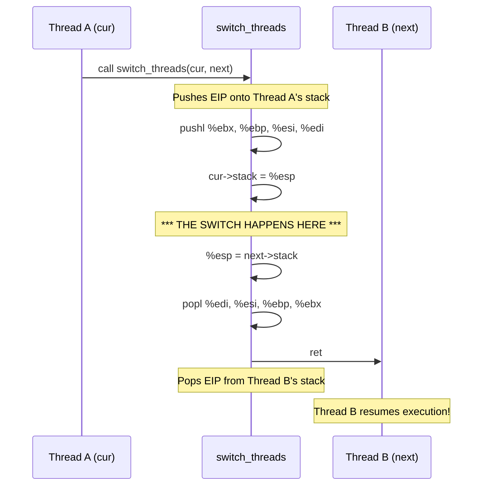

# Context Switching — switch.S & switch.h

## 1. Executive Summary & Mental Model

Context switching is the **sleight of hand** that makes multitasking possible. It's the moment when the CPU stops executing one thread and starts executing another. In Pintos, this magic happens in a few lines of assembly language in `switch.S`.

**Real-world analogy**: Imagine a surgeon (the CPU) operating on Patient A. Suddenly, an emergency happens. The surgeon must operate on Patient B. 
1. The surgeon writes down exactly where they left off with Patient A (saves state).
2. The surgeon reads their notes on where they left off with Patient B (restores state).
3. The surgeon resumes operating on Patient B.

**Primary CS problems solved**:
- Pausing execution without losing progress.
- Resuming execution exactly where it was paused.
- Ensuring the C code calling the switch doesn't realize it was paused (transparent suspension).

## 2. Theoretical Foundations

### ABI Register Saving Conventions

The System V ABI for x86 dictates which registers a function must preserve across a call (callee-saved) and which it can overwrite (caller-saved).

| Callee-Saved (Must Preserve) | Caller-Saved (May Destroy) |
|---|---|
| `%ebx`, `%ebp`, `%esi`, `%edi`, `%esp` | `%eax`, `%ecx`, `%edx` |

When `thread.c:schedule()` calls `switch_threads()`, the C compiler automatically saves `%eax`, `%ecx`, `%edx` if it needs them later, by pushing them to the stack before the `call` instruction.

Therefore, `switch_threads()` only needs to save the **callee-saved** registers onto the old thread's stack, swap the stack pointer, and restore the callee-saved registers from the new thread's stack.

### The Stack Swap

A thread's entire execution context is represented by its **stack pointer** (`%esp`). If you swap `%esp`, you swap the thread. The registers are just data saved on that stack.

## 3. Architecture & Visual Topography

### Context Switch Flow



## 4. Source Code Anatomy & Deep Dive

### `switch.h` — Stack Frames

```c
struct switch_threads_frame 
  {
    uint32_t edi;               /*  0: Saved %edi. */
    uint32_t esi;               /*  4: Saved %esi. */
    uint32_t ebp;               /*  8: Saved %ebp. */
    uint32_t ebx;               /* 12: Saved %ebx. */
    void (*eip) (void);         /* 16: Return address. */
    struct thread *cur;         /* 20: switch_threads()'s CUR arg. */
    struct thread *next;        /* 24: switch_threads()'s NEXT arg. */
  };
```
This structure exactly mirrors the stack layout right after `switch_threads` pushes the callee-saved registers.

### `switch.S` — `switch_threads`

```asm
.globl switch_threads
.func switch_threads
switch_threads:
    # 1. Save caller's register state.
    pushl %ebx
    pushl %ebp
    pushl %esi
    pushl %edi

    # 2. Get offsetof(struct thread, stack) into %edx
.globl thread_stack_ofs
    mov thread_stack_ofs, %edx

    # 3. Save current stack pointer to old thread's struct
    movl SWITCH_CUR(%esp), %eax    # Get 'cur' argument
    movl %esp, (%eax,%edx,1)       # cur->stack = %esp

    # 4. Restore stack pointer from new thread's struct
    movl SWITCH_NEXT(%esp), %ecx   # Get 'next' argument
    movl (%ecx,%edx,1), %esp       # %esp = next->stack

    # 5. Restore caller's register state.
    popl %edi
    popl %esi
    popl %ebp
    popl %ebx
    ret                            # Pop EIP and jump to it
.endfunc
```

Notice the symmetry: push, save `esp`, load `esp`, pop, `ret`.

### `switch.S` — `switch_entry`

When a thread is newly created, it has never run before. It has no history, no saved registers from a previous `switch_threads` call. To make it start running smoothly, `thread_create()` fakes a stack frame so that `switch_threads` *thinks* the thread was paused inside `switch_entry`.

```asm
.globl switch_entry
.func switch_entry
switch_entry:
    # Discard switch_threads() arguments.
    addl $8, %esp

    # Call thread_schedule_tail(prev).
    pushl %eax                     # Push 'prev' argument (returned in %eax)
.globl thread_schedule_tail
    call thread_schedule_tail
    addl $4, %esp                  # Clean up argument

    # Start thread proper.
    ret                            # Jumps to kernel_thread()
.endfunc
```

## 5. Runtime Execution & Sequence

### The First Switch to a New Thread

Let's trace exactly how a new thread starts running for the very first time.

1. **`thread_create()`**: Sets up three fake stack frames at the top of the new thread's stack:
   - `struct kernel_thread_frame` (points to the actual thread function)
   - `struct switch_entry_frame` (points to `kernel_thread`)
   - `struct switch_threads_frame` (points to `switch_entry`)
2. **`schedule()`**: Thread A yields, calls `switch_threads(A, B)`.
3. **`switch_threads()`**:
   - Saves Thread A's state on A's stack.
   - Loads Thread B's stack pointer.
   - Pops the faked registers (`%edi`, `%esi`, `%ebp`, `%ebx`).
   - Executes `ret`.
4. **`ret` in `switch_threads`**: Pops the next value from B's stack, which `thread_create` set to `switch_entry`. CPU jumps to `switch_entry`.
5. **`switch_entry`**:
   - Calls `thread_schedule_tail(A)` to clean up Thread A if it died.
   - Executes `ret`.
6. **`ret` in `switch_entry`**: Pops the next value from B's stack, which `thread_create` set to `kernel_thread`. CPU jumps to `kernel_thread`.
7. **`kernel_thread()`**:
   - Enables interrupts.
   - Calls the actual `function(aux)`.
   - Calls `thread_exit()` when done.

## 6. Edge Cases, Failure Modes & Resilience

| Issue | Consequence | Prevention |
|---|---|---|
| Interrupts enabled during switch | Stack corruption | `schedule()` requires `INTR_OFF` before calling `switch_threads()`. |
| Modifying `struct thread` layout | `thread_stack_ofs` mismatch | `thread.c` calculates the offset using `offsetof()` dynamically, and `switch.S` imports it, preventing hardcoded offset errors. |
| Returning wrong thread in `%eax` | `thread_schedule_tail` gets wrong `prev` thread | The x86 C calling convention requires the return value to be in `%eax`. `switch_threads` leaves `%eax` alone after line 36, which contains the `cur` thread pointer. Thus, `cur` is naturally returned! |

## 7. Hands-On Verification & Challenges

<details>
<summary><strong>Q1: In switch_threads, why do we use <code>SWITCH_CUR(%esp)</code> to access the <code>cur</code> argument? What is the value of <code>SWITCH_CUR</code>?</strong></summary>

Arguments to C functions are pushed onto the stack right-to-left before the `call` instruction. The `call` instruction pushes the return address (EIP). Inside `switch_threads`, we push 4 registers (4 * 4 = 16 bytes). So the `cur` argument is at offset 16 + 4 (EIP) = 20 from the current stack pointer. `switch.h` defines `SWITCH_CUR` as 20.
</details>

<details>
<summary><strong>Q2: How does the new thread get the pointer to the previous thread to pass to <code>thread_schedule_tail</code>?</strong></summary>

In x86, function return values are stored in the `%eax` register. In `switch_threads`, line 36 (`movl SWITCH_CUR(%esp), %eax`) loads the `cur` pointer into `%eax`. The rest of the function doesn't modify `%eax`. When `switch_threads` returns, `%eax` still contains `cur` (the previous thread). When `switch_entry` starts, it pushes `%eax` as the argument to `thread_schedule_tail`.
</details>

## 8. Lab Modifications Guide

These files are **not modified in any lab**. They provide the low-level assembly plumbing that makes multitasking work. Understanding this process is crucial for debugging stack overflows and tracing execution through a context switch.
