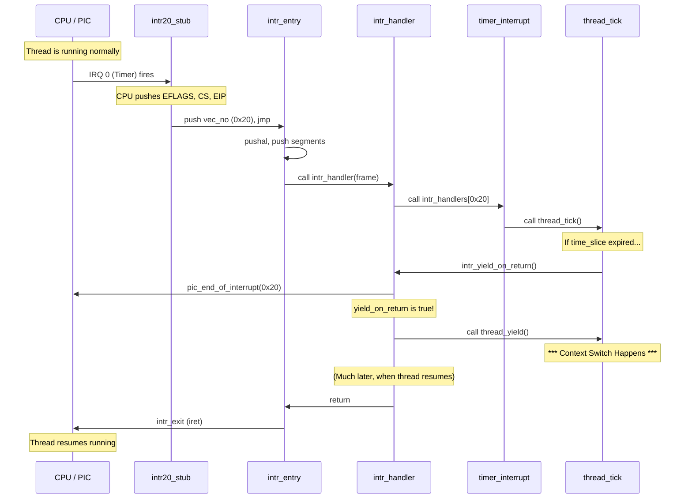

# Interrupt Handling — interrupt.c & intr-stubs.S

## 1. Executive Summary & Mental Model

Interrupts are how the CPU communicates with the outside world and handles its own errors. When a hardware device (like a timer or keyboard) needs attention, or when a program does something illegal (like dividing by zero or accessing unmapped memory), the CPU **interrupts** whatever it is currently doing to handle the event.

**Real-world analogy**: 
Imagine you are deeply focused on reading a book (the CPU executing a user program).
- **External Interrupt**: Your phone rings (hardware device). You put a bookmark in your book (save state), answer the phone (interrupt handler), hang up, and resume reading.
- **Internal Exception**: You encounter a word in a language you don't understand (page fault). You put a bookmark in, grab a dictionary (exception handler), resolve it, and resume reading.
- **Software Interrupt**: You decide to call your friend for help with a math problem (system call `int 0x30`).

**Primary CS problems solved**:
- Asynchronous hardware event notification.
- CPU fault and exception handling.
- Safe transitions from user mode to kernel mode (system calls).

## 2. Theoretical Foundations

### x86 Interrupt Architecture

The x86 architecture supports 256 unique **interrupt vectors** (0 to 255). 
- **0x00 - 0x1F (0-31)**: CPU Exceptions (Page Fault, General Protection Fault, Divide by Zero).
- **0x20 - 0x2F (32-47)**: Hardware Interrupts mapped from the PIC (Timer = 0x20, Keyboard = 0x21).
- **0x30 (48)**: Pintos System Call Vector (Software interrupt).

When an interrupt occurs, the CPU:
1. Looks up the vector in the **Interrupt Descriptor Table (IDT)**.
2. Pushes the current `EFLAGS`, `CS`, and `EIP` onto the stack (the "bookmark").
3. (If changing privilege levels, like user to kernel) Switches to the kernel stack and pushes `SS` and `ESP`.
4. Pushes an error code (for some exceptions).
5. Jumps to the address specified in the IDT.

### The 8259A PIC (Programmable Interrupt Controller)

PCs have two cascaded PIC chips that manage hardware IRQs (Interrupt Requests). Pintos reprograms the PICs during `intr_init()` so that IRQ 0-15 map to interrupt vectors 0x20-0x2F, getting them out of the way of the CPU exceptions (0x00-0x1F).

## 3. Architecture & Visual Topography

### The Interrupt Stack Frame

When an interrupt fires, the CPU and the Pintos assembly stubs build this structure on the stack:

```
Higher Addresses (Bottom of stack)
+----------------+
|      SS        | \ 
|     ESP        |  | Pushed by CPU (only if crossing privilege rings)
+----------------+ /
|    EFLAGS      | \
|      CS        |  | Pushed by CPU always
|     EIP        | /
+----------------+
|  error_code    | <-- Pushed by CPU (sometimes) or by stub (as 0)
|    vec_no      | <-- Pushed by stub
+----------------+
|      EAX       | \
|      ECX       |  |
|      EDX       |  |
|      EBX       |  | Pushed by 'pushal' in intr_entry
|   esp_dummy    |  |
|      EBP       |  |
|      ESI       |  |
|      EDI       | /
+----------------+
|      DS        | \
|      ES        |  | Pushed by intr_entry
|      FS        |  |
|      GS        | /
+----------------+ <-- ESP points here when intr_handler is called
Lower Addresses (Top of stack)
```
This exact layout corresponds to `struct intr_frame` in `interrupt.h`.

## 4. Source Code Anatomy & Deep Dive

### Phase 1: `intr-stubs.S` (The Assembly Entry Points)

Because the CPU jumps to a specific address based on the interrupt number, Pintos generates 256 tiny assembly functions (`intr00_stub` to `intrff_stub`) using macros.

```asm
#define STUB(NUMBER, TYPE)                      \
.func intr##NUMBER##_stub;                      \
intr##NUMBER##_stub:                            \
    TYPE;                  /* Push dummy error code if needed */ \
    push $0x##NUMBER;      /* Push vector number */ \
    jmp intr_entry;        /* Jump to common handler */ \
.endfunc;
```

All 256 stubs jump to `intr_entry`:
```asm
intr_entry:
    pushl %ds; pushl %es; pushl %fs; pushl %gs  # Save segments
    pushal                                      # Save general registers (EAX..EDI)
    
    mov $SEL_KDSEG, %eax                        # Switch to kernel data segment
    mov %eax, %ds; mov %eax, %es
    
    pushl %esp                                  # Pass stack pointer as argument
    call intr_handler                           # Call the C handler!
```

### Phase 2: `interrupt.c:intr_handler()`

The common C function that dispatches the interrupt.

```c
void intr_handler (struct intr_frame *frame) 
{
  bool external = frame->vec_no >= 0x20 && frame->vec_no < 0x30;

  if (external) {
      in_external_intr = true;
      yield_on_return = false;
  }

  /* Invoke the registered handler! */
  intr_handler_func *handler = intr_handlers[frame->vec_no];
  if (handler != NULL)
    handler (frame);
  else
    unexpected_interrupt (frame);

  if (external) {
      in_external_intr = false;
      pic_end_of_interrupt (frame->vec_no);  // Tell PIC we are done

      // If the timer handler requested a yield, do it now, 
      // just before returning to the interrupted thread.
      if (yield_on_return) 
        thread_yield (); 
  }
}
```

### Phase 3: Returning (`intr_exit`)

After `intr_handler` returns, execution falls through to `intr_exit` in `intr-stubs.S`:

```asm
intr_exit:
    popal                    # Restore general registers
    popl %gs; popl %fs; popl %es; popl %ds
    addl $12, %esp           # Discard vec_no and error_code
    iret                     # Return from interrupt!
```
The `iret` instruction is magic: it pops EIP, CS, and EFLAGS. If returning to user mode, it also pops ESP and SS, completely restoring the interrupted program's state.

## 5. Runtime Execution & Sequence

### Timer Interrupt Sequence



## 6. Edge Cases, Failure Modes & Resilience

| Scenario | Consequence | Defense |
|---|---|---|
| Hardware interrupt while interrupts disabled (`cli`) | Interrupt is held pending by the PIC/CPU until `sti` | That's the point of `intr_disable()`: it protects critical sections from hardware preemption. |
| Nested external interrupts | Stack overflow, race conditions | Pintos enforces that external interrupts run with interrupts *disabled*. They never nest. |
| Page fault inside an interrupt handler | Kernel Panic | Interrupt handlers must be bug-free and cannot block or page fault. |

## 7. Hands-On Verification & Challenges

<details>
<summary><strong>Q1: Why does <code>intr_handler</code> check <code>yield_on_return</code> instead of calling <code>thread_yield()</code> immediately inside <code>timer_interrupt</code>?</strong></summary>

If `timer_interrupt` called `thread_yield()` directly, the context switch would happen *before* the interrupt handler finished. The PIC would never receive the `pic_end_of_interrupt` signal, meaning no further timer interrupts would ever fire, freezing the system. By setting a flag, the yield is delayed until the PIC is acknowledged.
</details>

<details>
<summary><strong>Q2: How do you disable interrupts in Pintos, and why is it dangerous?</strong></summary>

Use `enum intr_level old = intr_disable();` and later `intr_set_level(old);`. Disabling interrupts is dangerous because it stops the timer (no preemption) and the keyboard (no input). It should only be used for very short, critical sections of code (like manipulating the `ready_list`).
</details>

## 8. Lab Modifications Guide

This file is **not modified in any lab**. 
However, you heavily rely on `intr_disable()` and `intr_set_level()` in **Project 1 (Threads)** to implement synchronization primitives (semaphores, locks) and to protect priority scheduling queues.

In **Project 2 (User Programs)**, you will use `intr_frame` extensively. The system call handler (`syscall_handler`) receives a `struct intr_frame *f`, and you must read the user's stack pointer (`f->esp`) and registers (like `f->eax`) to execute system calls. You also use `intr_exit` to "fake" an interrupt return to launch the very first user program.
