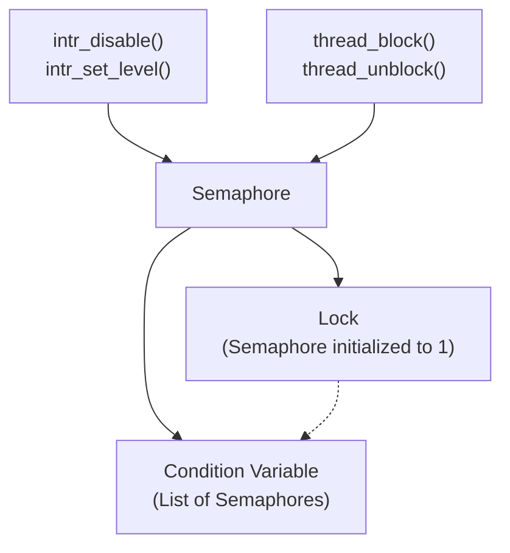
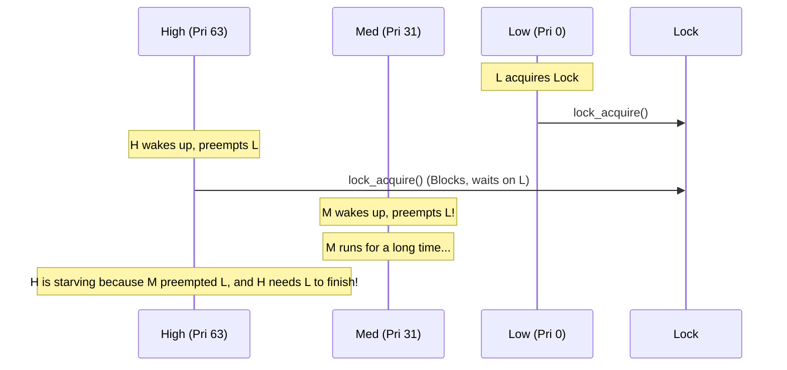

# Synchronization Primitives — synch.h & synch.c ⭐ P1

## 1. Executive Summary & Mental Model

Pintos provides three main synchronization primitives: **Semaphores**, **Locks**, and **Condition Variables**. These tools allow multiple threads to coordinate their actions and safely share resources without stepping on each other's toes (race conditions).

**Real-world analogy**: 
- **Semaphore (value = N)**: A parking lot with N spaces. A guard lets cars in (`sema_down`) until it's full. When a car leaves (`sema_up`), the guard lets the next waiting car in.
- **Lock (value = 1)**: A bathroom key. Only one person can have it at a time. The person who took the key must be the one to return it.
- **Condition Variable**: A pager system at a restaurant. You hold the lock (you are at the host stand), you realize your table isn't ready, so you give back the lock and take a pager (`cond_wait`). When the host buzzes your pager (`cond_signal`), you go back to the host stand (reacquire the lock).

**Primary CS problems solved**:
- Mutual exclusion for critical sections.
- Thread signaling and coordination.
- Deadlock prevention.

## 2. Theoretical Foundations

### Atomicity via Interrupt Disabling

At the lowest level, all synchronization in Pintos is built on top of **interrupt disabling**. 
If thread A is modifying a shared list, it must not be preempted by thread B (via a timer interrupt) because B might see the list in an inconsistent state.

By calling `intr_disable()`, the CPU ignores the timer interrupt. This guarantees that a short block of code executes **atomically** (all at once, without interruption).

### Base Primitive: The Semaphore

In Pintos, **Locks and Condition Variables are both built entirely out of Semaphores**. Understanding the semaphore is the key to understanding the entire file.

A semaphore is just an integer `value` and a `waiters` list.
- `sema_down (P)`: If `value == 0`, sleep (block). Otherwise, `value--`.
- `sema_up (V)`: `value++`. If anyone is sleeping, wake one of them up.

## 3. Architecture & Visual Topography

### Component Relationships



## 4. Source Code Anatomy & Deep Dive

### `struct semaphore`

```c
struct semaphore 
  {
    unsigned value;             /* Current value. */
    struct list waiters;        /* List of waiting threads. */
  };
```

#### `sema_down()`

```c
void sema_down (struct semaphore *sema) 
{
  enum intr_level old_level;

  old_level = intr_disable ();   // 1. Disable interrupts for atomicity
  while (sema->value == 0)       // 2. While no resources available...
    {
      // 3. Add current thread to the semaphore's wait list
      list_push_back (&sema->waiters, &thread_current ()->elem);
      
      // 4. Put the thread to sleep. (Context switch happens here!)
      thread_block ();
      
      // 5. When it wakes up, it re-evaluates the while loop condition.
    }
  sema->value--;                 // 6. Claim the resource
  intr_set_level (old_level);    // 7. Restore interrupts
}
```

#### `sema_up()`

```c
void sema_up (struct semaphore *sema) 
{
  enum intr_level old_level;

  old_level = intr_disable ();
  if (!list_empty (&sema->waiters)) 
    // Pop first waiter and wake them up (move to ready_list)
    thread_unblock (list_entry (list_pop_front (&sema->waiters),
                                struct thread, elem));
  sema->value++;
  intr_set_level (old_level);
}
```

### Locks

A Lock is literally just a semaphore with an initial value of 1, plus a pointer tracking who currently holds it (for debugging and priority donation).

```c
struct lock 
  {
    struct thread *holder;      /* Thread holding lock. */
    struct semaphore semaphore; /* Binary semaphore controlling access. */
  };

void lock_acquire (struct lock *lock) {
  sema_down (&lock->semaphore);
  lock->holder = thread_current ();
}

void lock_release (struct lock *lock) {
  lock->holder = NULL;
  sema_up (&lock->semaphore);
}
```

### Condition Variables

A Condition Variable requires you to hold a lock before calling `cond_wait`.
It creates a **temporary semaphore** initialized to 0, adds it to the condition variable's list, releases the main lock, and then `sema_down`s on the temporary semaphore (going to sleep).

```c
void cond_wait (struct condition *cond, struct lock *lock) 
{
  struct semaphore_elem waiter;
  
  sema_init (&waiter.semaphore, 0);                  // Create local semaphore
  list_push_back (&cond->waiters, &waiter.elem);     // Add to condition's list
  lock_release (lock);                               // Give up the lock
  sema_down (&waiter.semaphore);                     // Go to sleep!
  lock_acquire (lock);                               // Reacquire lock upon waking
}
```
*Note*: The `waiter` semaphore is allocated on the thread's stack. Because the thread sleeps on `sema_down`, the stack variable stays alive until the thread wakes up.

## 5. Runtime Execution & Sequence

### Priority Inversion

A major issue you must fix in Project 1 is **Priority Inversion**. 
Assume: High Priority (H), Medium Priority (M), Low Priority (L).


In this scenario, M effectively runs with a higher priority than H.

## 6. Edge Cases, Failure Modes & Resilience

| Scenario | Defense |
|---|---|
| Calling `sema_down` in an interrupt handler | `ASSERT(!intr_context())`. Interrupt handlers cannot sleep, so they cannot wait on semaphores. Use `sema_try_down` instead. |
| Releasing a lock held by someone else | `ASSERT(lock_held_by_current_thread(lock))` in `lock_release()`. Only the owner can release a lock. |
| Releasing a lock you don't hold | Same assertion as above. |

## 7. Hands-On Verification & Challenges

<details>
<summary><strong>Q1: Why does <code>sema_down</code> use a <code>while (sema->value == 0)</code> loop instead of an <code>if</code> statement?</strong></summary>

Because Pintos implements Mesa-style semantics. When a thread is woken up by `sema_up`, it is placed on the `ready_list`. It does not get the CPU immediately. By the time it actually gets scheduled to run and returns from `thread_block()`, another thread might have grabbed the CPU and taken the semaphore! The `while` loop forces the woken thread to double-check that the resource is still available.
</details>

## 8. Lab Modifications Guide

### ⭐ P1: Priority Donating Semaphores

**Task 1: Priority-Aware Waiters Lists**
Currently, `sema_up` and `cond_signal` wake up the thread at the *front* of the `waiters` list (FIFO). In P1, they must wake up the **highest priority thread** waiting.
*   **Action**: Change `list_push_back()` to `list_insert_ordered()` in `sema_down` and `cond_wait`, OR change `list_pop_front()` to use `list_max()` in `sema_up` and `cond_signal`. 

### ⭐ P1: Priority Donation (Locks)

You must implement **Multiple Priority Donation** and **Nested Priority Donation**.

**Task 1: Donating Priority on Acquire**
Modify `lock_acquire()`:
1. If the lock is held by another thread, and that thread's priority is lower than ours:
2. **Donate**: Set the holder's priority to our priority.
3. If the holder is waiting on *another* lock, follow the chain and donate to that holder as well (Nested donation, up to depth 8 is usually sufficient).
4. You must record this donation in the holder's `struct thread` (e.g., in a list of received donations) so it knows who donated what.

**Task 2: Revoking Priority on Release**
Modify `lock_release()`:
1. When a thread releases a lock, it must **revoke** the donations associated with that lock.
2. The thread's priority should revert to the maximum of its base priority and the priorities of threads still waiting on *other* locks it holds.
3. (Hint: Keeping a sorted list of acquired locks or a list of donators in `struct thread` makes this much easier).

*Important invariant*: The MLFQS scheduler (`-mlfqs`) does **not** use priority donation. You must disable donation logic if `thread_mlfqs` is true.
