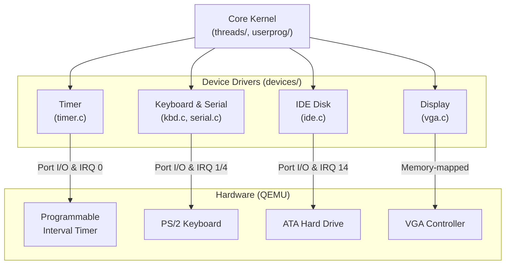

# Device Drivers — Overview

## 1. Executive Summary & Mental Model

The `devices/` directory in Pintos contains the code that talks directly to the physical hardware of the computer (or in our case, the emulated hardware in QEMU/Bochs). 

**Real-world analogy**: 
If the threading system is the manager of the restaurant, and the user programs are the customers, then the **device drivers are the appliances** (the stove, the cash register, the PA system). The drivers provide a standard set of buttons (functions) so the manager doesn't have to know the electrical wiring of the stove to turn it on.

## 2. Theoretical Foundations

### The Problem of Hardware

Hardware is messy, slow, and specific. An IDE hard drive communicates very differently from a VGA monitor. Operating systems use **Device Drivers** to abstract away this complexity. The kernel just calls `printf()`, and the device driver figures out how to light up the correct pixels on the screen and send the bytes out the serial port.

### Polling vs. Interrupts

There are two ways a driver can wait for a slow hardware device to finish a task:
1. **Polling (Busy-Waiting)**: The CPU repeatedly asks the device "Are you done yet? Are you done yet?" in a tight loop. This wastes 100% of the CPU's time.
2. **Interrupt-driven**: The CPU tells the device "Do this task, and ring the doorbell (interrupt) when you're done." The CPU can go run other threads in the meantime.

Pintos uses a mix. Early boot output uses polling. Disk I/O and the timer use interrupts.

## 3. Architecture & Visual Topography

## 4. Key Devices in Pintos

| Device | File | Purpose | Modified in Labs? |
|---|---|---|---|
| **Timer** | `timer.c` | Generates 100 ticks per second for the scheduler. | ⭐ **Yes (P1)** |
| **VGA** | `vga.c` | Writes text to the screen. | No |
| **Serial** | `serial.c` | Sends text to the terminal (used for testing output). | No |
| **Keyboard** | `kbd.c` | Reads keystrokes. | No |
| **IDE** | `ide.c` | Reads/writes sectors to the hard disk. | No |
| **RTC** | `rtc.c` | Real-Time Clock (gets the current date/time). | No |
| **Shutdown** | `shutdown.c` | Powers off the emulator. | No |

## 5. Lab Modifications Guide

The **only** device driver you need to modify in standard Pintos projects is the **Timer** (`timer.c`) in Project 1. The rest of the devices work out of the box to support your kernel and file system.
