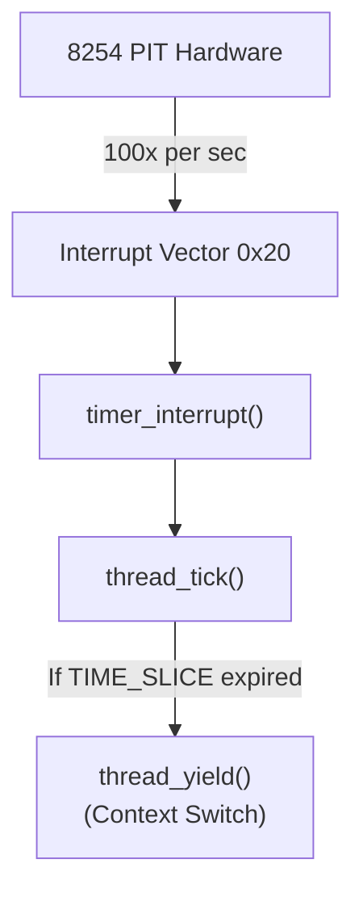
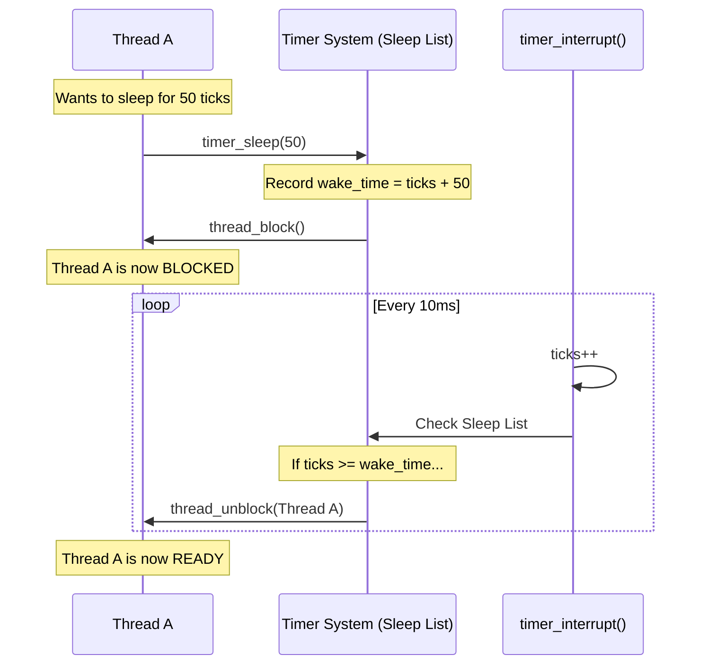

# The System Timer — timer.c & timer.h ⭐ P1

## 1. Executive Summary & Mental Model

The timer is the **metronome of the operating system**. It is a hardware chip (the 8254 Programmable Interval Timer) that sends an interrupt to the CPU exactly 100 times per second. 

This steady beat is used for two primary purposes:
1. **Timekeeping**: Knowing how long the system has been running (`timer_ticks()`).
2. **Preemption**: Forcing the current thread to yield the CPU so another thread can run.

**Real-world analogy**: 
Imagine a teacher (the Timer) in a classroom with one toy (the CPU) and many children (threads). Every 5 minutes, the teacher blows a whistle (timer interrupt). The child holding the toy must hand it to the next child in line.

**Primary CS problems solved**:
- Implementing `sleep()` functionality.
- Preventing threads from monopolizing the CPU (infinite loops).
- CPU usage profiling (for MLFQS).

## 2. Theoretical Foundations

### The 8254 PIT (Programmable Interval Timer)

The PIT is configured during `timer_init()` to fire at `TIMER_FREQ` (100 Hz, meaning 100 times a second, or every 10 milliseconds).
It fires an interrupt on IRQ 0, which maps to interrupt vector `0x20` in Pintos.

### Busy-Waiting vs. Sleeping

The provided implementation of `timer_sleep(ticks)` in Pintos uses **busy-waiting**:
```c
void timer_sleep (int64_t ticks) {
  int64_t start = timer_ticks ();
  while (timer_elapsed (start) < ticks) 
    thread_yield ();
}
```
This loop runs continuously. The thread yields, gets put back on the `ready_list`, gets scheduled again, checks the time, and yields again. It wastes massive amounts of CPU cycles and battery power just asking "Are we there yet?"

A proper OS uses **blocking sleep**. The thread is removed from the `ready_list` entirely and put on a "sleep list". The timer interrupt wakes it up *only* when its specific time has expired.

## 3. Architecture & Visual Topography



## 4. Source Code Anatomy & Deep Dive

### Global Variables

- `static int64_t ticks`: The master clock. Incremented by 1 every time the timer interrupt fires.
- `static unsigned loops_per_tick`: Used for calibration of sub-tick micro-delays.

### `timer_interrupt()`

```c
static void timer_interrupt (struct intr_frame *args UNUSED)
{
  ticks++;             // Advance the system clock
  thread_tick ();      // Tell the thread system a tick happened
}
```
This is registered in `timer_init()` to run on IRQ 0. Notice it doesn't do any context switching directly; `thread_tick()` is responsible for deciding if a yield is necessary, and if so, it calls `intr_yield_on_return()`.

### `timer_sleep()`

The function you must rewrite for Project 1. Currently, it just spins in a `while` loop calling `thread_yield()`.

## 5. Runtime Execution & Sequence

### How the Timer Wakes a Sleeping Thread (Ideal Implementation)

Once you fix `timer_sleep` in Project 1, the sequence should look like this:



## 6. Edge Cases, Failure Modes & Resilience

| Scenario | Consequence | Pintos Defense / Your Job |
|---|---|---|
| Reading `ticks` directly from another file | Race condition. A 64-bit read on a 32-bit x86 architecture takes two instructions. An interrupt could fire between them, giving a corrupted value. | `timer_ticks()` disables interrupts, reads `ticks`, and re-enables them to ensure an atomic 64-bit read. |
| Negative sleep duration | Immediate return | Your implementation of `timer_sleep` should check if `ticks <= 0` and return immediately. |

## 7. Hands-On Verification & Challenges

<details>
<summary><strong>Q1: Why is busy-waiting particularly bad in a strict priority scheduler (which you build in P1)?</strong></summary>

If a high-priority thread calls the original `timer_sleep()`, it yields. The scheduler looks for the highest priority thread to run next. Since the sleeping thread is still in the `ready_list` and has the highest priority, the scheduler instantly schedules it again! The high-priority thread will continuously spin, completely starving all lower-priority threads.
</details>

## 8. Lab Modifications Guide

### ⭐ P1: Alarm Clock (Efficient Sleep)

**Task**: Rewrite `timer_sleep()` to block the thread instead of busy-waiting.

**Implementation Plan**:

1. **The Sleep List**: Create a list in `timer.c` to hold sleeping threads. (e.g., `static struct list sleep_list;`). Initialize it in `timer_init()`.

2. **Tracking Wake Time**: Add a field to `struct thread` in `thread.h`:
   ```c
   int64_t wake_ticks; // The tick count when this thread should wake up
   ```

3. **Modifying `timer_sleep`**:
   - Assert that interrupts are enabled.
   - If `ticks <= 0`, return.
   - Disable interrupts (to safely modify the sleep list).
   - Calculate the wake time: `thread_current()->wake_ticks = timer_ticks() + ticks;`
   - Insert the thread into the `sleep_list`. (Using `list_insert_ordered()` based on `wake_ticks` makes the interrupt handler faster).
   - Call `thread_block()` to put the thread to sleep.
   - Re-enable interrupts.

4. **Modifying `timer_interrupt`**:
   - On every tick, scan the `sleep_list`.
   - If any thread's `wake_ticks <= ticks`:
     - Remove it from the `sleep_list`.
     - Call `thread_unblock()` to wake it up.
   - *(Optimization)*: If the list is ordered by `wake_ticks`, you only need to check the front of the list, and you can stop scanning as soon as you find a thread that isn't ready to wake up yet. This keeps the interrupt handler lightning fast!
