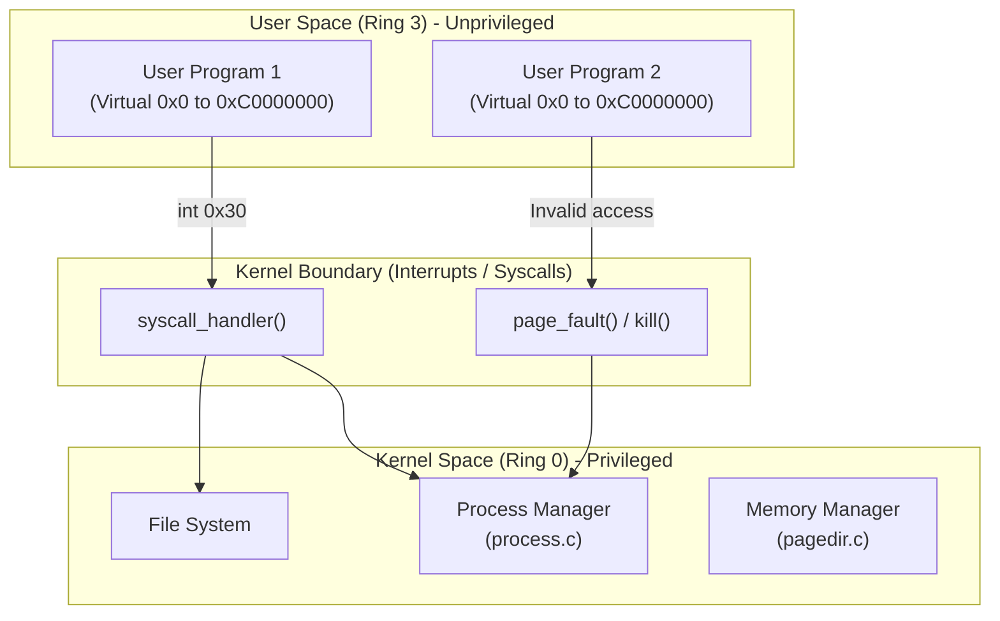

# User Programs — Overview

## 1. Executive Summary & Mental Model

Up until this point, all the code running in Pintos (the threads, the drivers, the scheduler) runs in **Kernel Mode** (Ring 0). It has total access to all memory and all hardware instructions. 

**User Programs** (Project 2) introduces a new paradigm: running untrusted code in **User Mode** (Ring 3). User programs cannot directly access hardware, cannot disable interrupts, and cannot read or write kernel memory. They are completely isolated. 

**Real-world analogy**: 
The kernel is the **Kitchen** in a restaurant, and user programs are the **Customers** in the dining area.
- Customers (User mode) cannot walk into the kitchen and cook their own food (Hardware I/O, modifying memory).
- If a customer wants food, they must write their order on a ticket and give it to a waiter (System Call).
- The waiter (System Call Handler) takes the ticket to the kitchen (Kernel mode). The kitchen checks if the order is valid, prepares it, and returns the food to the customer.
- If a customer tries to sneak into the kitchen or misbehaves, the bouncer (Exception Handler / Page Fault) kicks them out (kills the process).

## 2. Theoretical Foundations

### Isolation via Virtual Memory

How does the OS prevent a user program from reading another program's memory, or the kernel's memory?
By using **Page Directories**. 
Every user process gets its own unique Page Directory. When process A is running, the CPU translates virtual address `0x08048000` to physical page 5. When process B is running, the OS swaps the page directory. Now, `0x08048000` translates to physical page 12. Process A literally cannot form a memory address that points to Process B's memory.

### Executable and Linkable Format (ELF)

User programs on Pintos (and Linux) are compiled into ELF binaries. An ELF file contains:
- An **Executable Header** (Entry point address, architecture type).
- **Program Headers** (Segments). For example, it tells the OS: "Load the 500 bytes of code starting at file offset 0x40 into virtual memory address 0x08048000."
- **Data Sections** (Initialized variables).

Pintos parses this file in `process.c` to build the user's address space.

## 3. Architecture & Visual Topography

## 4. Lab Modifications Guide

In **Project 2 (User Programs)**, you will transform Pintos from a single-tasking kernel into a true operating system. Your primary tasks will be:
1. **Argument Passing**: Modifying `process_execute` to parse command-line arguments and push them onto the user's initial stack.
2. **System Calls**: Implementing `syscall_handler` to read arguments from the user's stack and safely execute kernel functions (like `open`, `read`, `write`, `exit`, `exec`, `wait`).
3. **Safe Memory Access**: Ensuring that pointers passed by user programs via system calls are valid, point to user memory, and don't cause page faults in the kernel.
