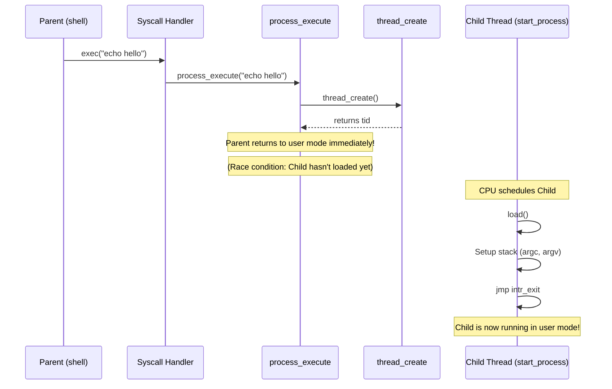

# Process Lifecycle — process.c & process.h ⭐ P2

## 1. Executive Summary & Mental Model

A "Process" in Pintos is simply a kernel thread that has an associated user virtual address space (a Page Directory). `process.c` is responsible for the entire lifecycle of these user processes: creating them, loading the executable code from the disk into memory, setting up their initial stack, and eventually destroying them.

**Real-world analogy**: 
- `thread_create`: Hiring a new employee.
- `process_execute` / `load`: Setting up the employee's office. You get the blueprints (ELF file), build the room (Page Directory), put the desk and computer in the right places (Code and Data segments), and give them a notepad (the User Stack).
- `process_exit`: Firing the employee and demolishing the office.

**Primary CS problems solved**:
- Binary loading (ELF parsing).
- Virtual memory initialization.
- Inter-process synchronization (Wait/Exit).

## 2. Theoretical Foundations

### The User Stack (Argument Passing)

When a C program starts, its `main` function expects arguments: `int main(int argc, char *argv[])`. 
Before the OS jumps to the program's entry point, it must manually construct this state on the user's stack.

The stack grows downwards from `PHYS_BASE` (`0xC0000000`).
The OS must push:
1. The actual string characters of the arguments.
2. Padding for word-alignment (4-byte boundaries).
3. Pointers to the strings (`argv[i]`).
4. A null pointer (`argv[argc]`).
5. A pointer to the `argv` array (`char **argv`).
6. The number of arguments (`int argc`).
7. A dummy return address (so the program crashes gracefully if `main` returns instead of calling `exit`).

## 3. Source Code Anatomy & Deep Dive

### `process_execute(file_name)`
1. Makes a copy of `file_name` into a new page. (This is necessary to avoid a race condition where the caller frees the string before the new thread reads it).
2. Calls `thread_create()` to spawn a new thread, passing `start_process` as the function to run.
3. *Crucial limitation*: Right now, `file_name` contains the whole command line (e.g., `"ls -l foo"`). `thread_create` uses this as the thread name, which is wrong. You must parse out just `"ls"` in Project 2.

### `start_process(file_name)`
This is the entry point for the newly created thread.
1. Initializes a fake `struct intr_frame`.
2. Calls `load()` to parse the ELF file and set up memory.
3. Uses inline assembly to jump to `intr_exit`, passing the fake interrupt frame. This "tricks" the CPU into thinking it is returning from an interrupt, causing an `iret` instruction that drops the CPU into User Mode (Ring 3) and jumps to the program's entry point!

### `load(file_name, eip, esp)`
1. Calls `pagedir_create()` to make a new virtual address space.
2. Opens the executable file.
3. Reads the ELF header.
4. Loops through the ELF Program Headers. For each loadable segment (Code, Data):
   - Allocates a physical page (`palloc_get_page(PAL_USER)`).
   - Reads data from the disk into the page.
   - Maps the physical page into the user's page directory (`install_page`).
5. Sets up the initial stack page (`setup_stack`).
6. Sets `*eip` to the entry point and `*esp` to the top of the stack.

### `process_wait(child_tid)`
Currently implemented as `return -1;`. In Project 2, this must block the calling thread until the specific child process terminates, and then return the child's exit status.

### `process_exit()`
Called when a process terminates. It destroys the page directory, freeing all physical memory allocated to the user process.

## 4. Runtime Execution & Sequence

### The `exec` Sequence

## 5. Lab Modifications Guide

### ⭐ P2: Argument Passing
In `process_execute`, you must tokenize `file_name` to extract the executable name (e.g., split `"echo hello"` into `"echo"` and `"hello"`). Pass the executable name to `thread_create`, but pass the full string to `start_process`.

In `start_process` (or `load`), you must implement **Argument Passing**.
After `setup_stack()` returns, `if_.esp` is pointing to `0xC0000000`. You must decrement `esp` and use `memcpy` to push the strings, the pointers, `argv`, `argc`, and the return address exactly as dictated by the 80x86 Calling Convention.

### ⭐ P2: Process Synchronization (Exec & Wait)
**The Exec Race Condition**:
`process_execute` currently returns immediately after `thread_create`. However, `exec` must return `-1` if the child program *fails to load* (e.g., file not found). 
- **Action**: You must use a semaphore to make the parent wait inside `process_execute` until the child finishes `load()`. The child must communicate the load success/failure back to the parent before waking it up.

**Process Wait**:
A parent can wait on a child. A child can exit before the parent waits, or the parent can wait before the child exits.
- **Action**: You need a shared data structure (like a `child_status` struct) that lives independently of the threads (because `struct thread` is freed when a thread exits).
- This structure should contain:
  1. The child's `tid`.
  2. The child's exit status.
  3. A semaphore (`wait_sema`) for the parent to sleep on.
  4. Reference counts or a boolean flag to track if the parent and child are both dead, so the struct can be `free()`d safely.

### ⭐ P2: Denying Write to Executables
While a user program is running, no one should be able to modify its executable file on disk.
- **Action**: In `load()`, keep the `struct file *` open. Call `file_deny_write(file)`. Store this file pointer in `struct thread`. In `process_exit()`, call `file_allow_write()` and `file_close()`.
